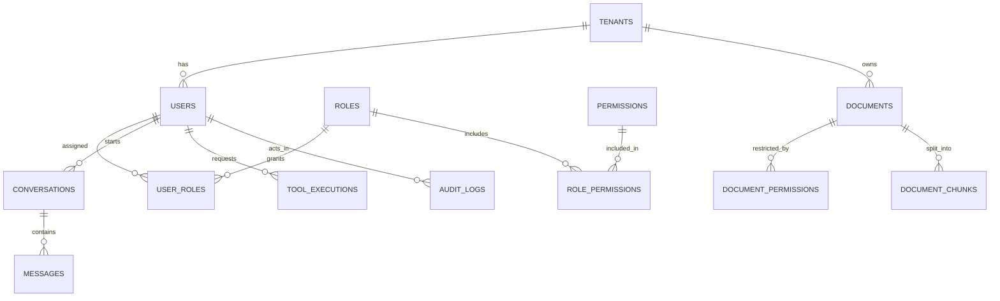

# EASA — Database Design

> **Status:** `documents` and `document_chunks` are implemented (Phase 2, P2-M1). All other entities in section 6 are a provisional design, not an implemented schema.
> Checked against the P2-M1 changes on 2026-11-14.

Related: [LLD](LLD.md) · [Architecture decisions](ARCHITECTURE_DECISIONS.md) · [Security](SECURITY.md)

## 1. Current state

| Item | Value |
|---|---|
| Engine | SQLite (Python's built-in `sqlite3`, SQLite 3.50.4 on the dev machine) |
| Default location | `apps/api/var/easa.db` (directory created on startup; git-ignored) |
| Tables | `documents`, `document_chunks` (plus Alembic's `alembic_version`) |
| Migrations | `7b339cea85fb` empty baseline → `eb5cd7e86396` documents and chunks (head) |
| ORM | SQLAlchemy 2.1 declarative models in [app/db/documents.py](../apps/api/app/db/documents.py), registered in [app/db/models.py](../apps/api/app/db/models.py) |
| File contents | Not in the database; stored content-addressed on disk (section 1.3) |

Tables are added only when a phase defines their requirements ([ADR-004](ARCHITECTURE_DECISIONS.md#adr-004)).

### 1.1 `documents`

| Column | Type | Null | Notes |
|---|---|---|---|
| `id` | UUID | no | Primary key (`pk_documents`), generated by the app |
| `tenant_id` | UUID | no | Isolation boundary. No foreign key until tenants exist (Phase 6) |
| `owner_id` | UUID | no | Uploading user. No foreign key until users exist (Phase 6) |
| `filename` | varchar(255) | no | Sanitized original name, display only; never a storage path |
| `media_type` | varchar(100) | no | `application/pdf`, DOCX (`application/vnd.openxmlformats-officedocument.wordprocessingml.document`) or `text/plain` (`ck_documents_media_type_allowed`) |
| `size_bytes` | integer | no | `> 0` (`ck_documents_size_positive`) |
| `sha256` | varchar(64) | no | Hex digest of the content; key into the file store |
| `status` | varchar(20) | no | `uploaded`, `processing`, `processed`, `failed` (`ck_documents_status_allowed`); default `uploaded` |
| `error_code` | varchar(64) | yes | Machine-readable failure reason; never raw exception text |
| `page_count` | integer | yes | `>= 0` when set (`ck_documents_page_count_non_negative`) |
| `created_at`, `updated_at` | timestamp with time zone | no | UTC, set by the app (`updated_at` on every update) |

Unique `(tenant_id, sha256)` (`uq_documents_tenant_id_sha256`): the same content uploaded twice in one tenant is one document (idempotency); different tenants may hold the same content. The constraint's index also serves tenant-scoped lookups, so there is no separate `tenant_id` index.

### 1.2 `document_chunks`

| Column | Type | Null | Notes |
|---|---|---|---|
| `id` | UUID | no | Primary key (`pk_document_chunks`) |
| `document_id` | UUID | no | Foreign key to `documents.id`, `ON DELETE CASCADE` (`fk_document_chunks_document_id_documents`) |
| `tenant_id` | UUID | no | Copied from the document so retrieval (Phase 3) can filter chunks by tenant without a join |
| `chunk_index` | integer | no | `>= 0`; unique per document (`uq_document_chunks_document_id_chunk_index`) |
| `text` | text | no | Normalized chunk text |
| `page_number` | integer | yes | 1-based; null for formats without pages (DOCX, TXT) |
| `section` | varchar(500) | yes | Nearest heading, when known |
| `char_start`, `char_end` | integer | no | Offsets into the document's normalized text; `0 <= char_start <= char_end` (`ck_document_chunks_offsets_valid`) |
| `created_at` | timestamp with time zone | no | UTC |

Access to a chunk is decided through its document (tenant now; document permissions in Phase 6). Embedding columns arrive in Phase 3 (section 8).

### 1.3 File storage

Uploaded bytes are stored by [LocalBlobStore](../apps/api/app/storage/blob_store.py) under `EASA_STORAGE_DIR` (default `apps/api/var/uploads/`, git-ignored) at `ab/cd/<sha256>`. Paths are derived only from a validated lowercase SHA-256 hex digest, so user-supplied names can never reach the filesystem. Writes go to a temporary file in the same directory and are renamed into place. Identical content is stored once. Files are never served directly. Deleting blobs (and reference counting across tenants) is not implemented yet.

### 1.4 Data access

[DocumentRepository](../apps/api/app/repositories/documents.py) takes a `tenant_id` in every method and filters by it: `get`, `get_by_sha256`, `list_for_tenant` (newest first, `limit` 1–200), `list_chunks`, and `replace_chunks` (deletes and re-adds a document's chunks, copying the document and tenant IDs onto each). It flushes but never commits.

### 1.5 Timestamps

Columns use [UtcDateTime](../apps/api/app/db/types.py): timezone-aware UTC on every backend. Naive datetimes are rejected on write; SQLite values (which carry no time zone) are returned with `tzinfo=UTC`. Migrations render it as `sa.DateTime(timezone=True)` through a `render_item` hook in `migrations/env.py`, so they never import application code.

## 2. Configuration

The database URL comes from `EASA_DATABASE_URL` (or `apps/api/.env`), validated by the application `Settings`. Allowed drivers: `sqlite`, `sqlite+pysqlite`, `postgresql+psycopg`. The value is a secret string: it is not shown in `repr()` or in validation errors. The app and Alembic read the same setting; `alembic.ini` holds no URL.

## 3. Engine — [app/db/engine.py](../apps/api/app/db/engine.py)

| Setting | Value | Reason |
|---|---|---|
| `pool_pre_ping` | `True` | Detect dropped connections before use |
| SQLite `check_same_thread` | `False` | FastAPI runs synchronous handlers in a thread pool |
| SQLite parent directory | created if missing | First run works without manual setup |
| SQLite `PRAGMA foreign_keys=ON` | on every connection | SQLite does not enforce foreign keys by default; this matches PostgreSQL behaviour |

The engine is created by the application factory and disposed on shutdown.

## 4. Sessions — [app/db/session.py](../apps/api/app/db/session.py)

| Function | Use | Transaction behaviour |
|---|---|---|
| `create_session_factory(engine)` | Once per app (`app.state.session_factory`) | `autoflush=False`, `expire_on_commit=False` |
| `session_scope(factory)` | Scripts and service-level units of work | Commits on success; rolls back on any exception; always closes |
| `iter_session(factory)` / `get_db_session` | FastAPI request dependency | **Never commits implicitly**; rolls back on exception; always closes |

Services decide when to commit. Route handlers do not commit.

## 5. Migrations

- Environment: [migrations/env.py](../apps/api/migrations/env.py) loads `Settings`, uses JSON logging, compares column types (`compare_type=True`) and enables batch mode on SQLite (`render_as_batch`), because SQLite cannot `ALTER` most constraints.
- File names are date-prefixed: `YYYYMMDD_<rev>_<slug>.py`.
- New migration files are formatted and lint-fixed by ruff through two Alembic post-write hooks of type `module` (`python -m ruff` with the current interpreter), which work on Windows, Linux and macOS.
- `scripts/check.ps1` and CI apply all migrations to a temporary database and run `alembic check`.
- Migrations run manually; the app does not migrate on startup.
- Every autogenerated migration must be reviewed before it is committed.

Verified commands (from `apps/api`):

```powershell
uv run alembic upgrade head
uv run alembic current
uv run alembic check
uv run alembic downgrade base
uv run alembic upgrade head --sql
uv run alembic revision --autogenerate -m "describe change"
```

Tests confirm a single migration head, an upgrade/downgrade round trip, that only `alembic_version` exists after upgrade, and that models and migrations are in sync.

## 6. Provisional logical model

> **PROPOSED, except `documents` and `document_chunks`, which are implemented (section 1).** This sketch exists to keep ownership and tenant boundaries in mind. Each table will be designed, reviewed and migrated in the phase that needs it, and may change.



| Entity | Purpose | Phase |
|---|---|---|
| `tenants` | Isolation boundary, if multi-tenancy is adopted | 6 (decision pending) |
| `users`, `roles`, `permissions`, `user_roles` | Identity and RBAC (employee, manager, administrator) | 6 |
| `documents` | Uploaded file metadata, owner, tenant, processing status, content hash for idempotent ingestion | 2 — **implemented** |
| `document_permissions` | Which roles or users may read a document | 2 / 6 |
| `document_chunks` | Chunk text, page and section, tenant copied from the document; embeddings in Phase 3 | 2 — **implemented** / 3 |
| `conversations`, `messages` | Chat history owned by a user | 4 / 7 |
| `tool_executions` | Tool name, arguments, requesting user, authorization result, outcome, correlation ID | 5 |
| `audit_logs` | Protected operations with actor, action, target, result, correlation ID | 5 / 6 |

## 7. Design rules for future tables

- Primary keys on every table; foreign keys for every relationship.
- Unique constraints where the domain requires uniqueness (for example, a document's content hash per tenant).
- `created_at` and `updated_at` timestamps (UTC).
- Explicit ownership and tenant columns where data belongs to someone; filters applied in the backend, never trusted from the browser.
- Indexes justified by real queries.
- Constraint names come from the naming convention below, so migrations behave the same on SQLite and PostgreSQL.
- Schema changes only through reviewed Alembic migrations.

Naming convention ([app/db/base.py](../apps/api/app/db/base.py)):

| Constraint | Pattern |
|---|---|
| Index | `ix_%(column_0_label)s` |
| Unique | `uq_%(table_name)s_%(column_0_N_name)s` (all columns, e.g. `uq_documents_tenant_id_sha256`) |
| Check | `ck_%(table_name)s_%(constraint_name)s` (allowed-value lists are explicit `CheckConstraint`s, not `Enum(create_constraint=True)`, so migrations get the same names) |
| Foreign key | `fk_%(table_name)s_%(column_0_name)s_%(referred_table_name)s` |
| Primary key | `pk_%(table_name)s` |

## 8. Vector data (Phase 3, planned)

When embeddings are introduced, each stored vector will record the embedding model name, version and dimensions. Vectors from incompatible models will never share a search space without explicit versioning and a re-embedding migration.

## 9. PostgreSQL path (Phase 3, planned)

1. Install the `psycopg` driver (allowed by configuration today, not installed).
2. Point `EASA_DATABASE_URL` at PostgreSQL and run `alembic upgrade head`.
3. Add the `pgvector` extension through a migration.
4. Run the integration tests against a real PostgreSQL instance.

## 10. Data handling

Only synthetic data is stored. Database files are git-ignored (`var/`, `*.db` with its journal, WAL and SHM files, `*.sqlite`, `*.sqlite3`). There is no backup or retention policy in Phase 1 because nothing of value is stored.
