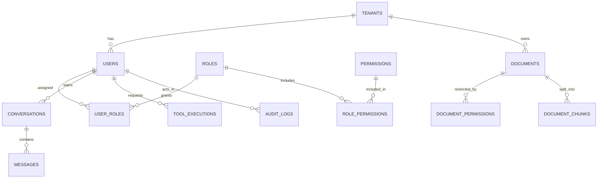

# EASA — Database Design

> **Status:** `documents`, `document_chunks` (Phase 2) and `chunk_embeddings` (Phase 3, P3-M1) are implemented. All other entities in section 6 are a provisional design, not an implemented schema.
> Checked against the P2-M1 changes on 2026-11-14.

Related: [LLD](LLD.md) · [Architecture decisions](ARCHITECTURE_DECISIONS.md) · [Security](SECURITY.md)

## 1. Current state

| Item | Value |
|---|---|
| Engine | SQLite (Python's built-in `sqlite3`, SQLite 3.50.4 on the dev machine) by default; PostgreSQL 18.7 with pgvector 0.8.7 through `psycopg` 3.3 (Docker Compose, section 9) |
| Default location | `apps/api/var/easa.db` (directory created on startup; git-ignored); PostgreSQL data lives in the Docker volume `easa_postgres-data` |
| Tables | `documents`, `document_chunks`, `chunk_embeddings`, `conversations`, `conversation_messages`, `audit_logs`, `support_tickets`, `pending_actions` (plus Alembic's `alembic_version`); keyword index: SQLite FTS5 table `chunk_fts` or a PostgreSQL GIN index (section 8.1) |
| Migrations | `7b339cea85fb` empty baseline → `eb5cd7e86396` documents and chunks → `e57f12a3d5ed` chunking config → `29b0c28209aa` chunk embeddings → `6d544dac46b3` keyword index (SQLite) → `e4353f12b34f` PostgreSQL search → `c0002f4a144e` conversations → `2883c37b9b4f` audit logs → `74e98c05b626` support tickets → `758b76fd91fc` pending actions (head) |
| ORM | SQLAlchemy 2.1 declarative models in [app/db/documents.py](../apps/api/app/db/documents.py), registered in [app/db/models.py](../apps/api/app/db/models.py) |
| File contents | Not in the database; stored content-addressed on disk (section 1.3) |

Tables are added only when a phase defines their requirements ([ADR-004](ARCHITECTURE_DECISIONS.md#adr-004)).

### 1.1 `documents`

| Column | Type | Null | Notes |
|---|---|---|---|
| `id` | UUID | no | Primary key (`pk_documents`), generated by the app |
| `tenant_id` | UUID | no | Isolation boundary. No foreign key until tenants exist (Phase 6) |
| `owner_id` | UUID | no | Uploading user. No foreign key until users exist (Phase 6) |
| `filename` | varchar(255) | no | Sanitized original name, display only; never a storage path |
| `media_type` | varchar(100) | no | `application/pdf`, DOCX (`application/vnd.openxmlformats-officedocument.wordprocessingml.document`) or `text/plain` (`ck_documents_media_type_allowed`) |
| `size_bytes` | integer | no | `> 0` (`ck_documents_size_positive`) |
| `sha256` | varchar(64) | no | Hex digest of the content; key into the file store |
| `status` | varchar(20) | no | `uploaded`, `processing`, `processed`, `failed` (`ck_documents_status_allowed`); default `uploaded`. Lifecycle: inserted as `uploaded` → `processing` (committed) → `processed` or `failed` within the same request. A row left `processing` by an interrupted request is reprocessed by an identical re-upload after 10 minutes |
| `error_code` | varchar(64) | yes | Machine-readable failure reason; never raw exception text |
| `page_count` | integer | yes | `>= 0` when set (`ck_documents_page_count_non_negative`); PDF page count after successful processing, otherwise null |
| `chunking_config` | JSON | yes | Chunking settings used for the stored chunks (`strategy`, `max_chars`, `overlap_chars`); null when there are no chunks. Lets retrieval quality be compared across configurations (Phase 3) |
| `created_at`, `updated_at` | timestamp with time zone | no | UTC, set by the app (`updated_at` on every update) |

Unique `(tenant_id, sha256)` (`uq_documents_tenant_id_sha256`): the same content uploaded twice in one tenant is one document (idempotency); different tenants may hold the same content. The constraint's index also serves tenant-scoped lookups, so there is no separate `tenant_id` index.

### 1.2 `document_chunks`

| Column | Type | Null | Notes |
|---|---|---|---|
| `id` | UUID | no | Primary key (`pk_document_chunks`) |
| `document_id` | UUID | no | Foreign key to `documents.id`, `ON DELETE CASCADE` (`fk_document_chunks_document_id_documents`) |
| `tenant_id` | UUID | no | Copied from the document so retrieval (Phase 3) can filter chunks by tenant without a join |
| `chunk_index` | integer | no | `>= 0`; unique per document (`uq_document_chunks_document_id_chunk_index`) |
| `text` | text | no | Normalized chunk text |
| `page_number` | integer | yes | 1-based; null for formats without pages (DOCX, TXT) |
| `section` | varchar(500) | yes | Nearest heading, when known |
| `char_start`, `char_end` | integer | no | Offsets into the document's normalized text; `0 <= char_start <= char_end` (`ck_document_chunks_offsets_valid`) |
| `created_at` | timestamp with time zone | no | UTC |

Chunks are written in the same transaction that marks the document `processed`; a failure discards partial chunks. Reprocessing would replace all chunks of a document (`replace_chunks`). Access to a chunk is decided through its document (tenant now; document permissions in Phase 6). Embedding columns arrive in Phase 3 (section 8).

### 1.2a `conversations` and `conversation_messages` (Phase 4, P4-M4)

[app/db/conversations.py](../apps/api/app/db/conversations.py), migration `c0002f4a144e`.

`conversations`: `id` (UUID, primary key), `tenant_id` and `owner_id` (UUIDs from the identity; no foreign keys until users and tenants exist), `created_at`, `updated_at` (set when a turn is added). Index `ix_conversations_tenant_id_owner_id_updated_at` serves "my recent conversations". There is no title column, which would be another copy of question text.

| `conversation_messages` column | Type | Null | Notes |
|---|---|---|---|
| `id` | UUID | no | Primary key |
| `conversation_id` | UUID | no | Foreign key to `conversations.id`, `ON DELETE CASCADE` |
| `tenant_id` | UUID | no | Copied from the conversation; message queries filter by it |
| `position` | integer | no | 0, 1, 2, … within the conversation (a question, then its reply); unique with `conversation_id` |
| `role` | varchar(16) | no | `user` or `assistant` (`ck_conversation_messages_role_allowed`) |
| `content` | text | yes | The normalized question, or the answer; null when the evidence was insufficient |
| `status`, `reason` | varchar(32) | yes | Assistant messages: `answered` / `insufficient_evidence` and the reason |
| `sources` | JSON | yes | Assistant messages: cited sources as `{label, document_id, filename, page_number, section, chunk_index, char_start, char_end}`, **never the chunk text** |
| `model_id` | varchar(200) | yes | Chat model that produced the reply |
| `created_at` | timestamp with time zone | no | UTC |

Rules: a question and its reply are written together in one transaction, only after the answer pipeline succeeds; a concurrent write at the same position fails on the unique constraint and returns `409 conversation_busy`. Deleting a conversation deletes its messages (database cascade). At most 50 turns per conversation. Cited documents can later be deleted or reprocessed; stored citations are then historical and may no longer resolve.

### 1.2b `audit_logs` (Phase 5, P5-M1)

[app/db/audit.py](../apps/api/app/db/audit.py), migration `2883c37b9b4f`. One row per attempt at a protected operation, whatever the outcome: tool executions (P5-M1), and since P6-M2 sign-ins, logouts, user administration and refused requests.

| Column | Type | Null | Notes |
|---|---|---|---|
| `id` | UUID | no | Primary key |
| `tenant_id`, `user_id` | UUID | no | Who attempted it (no foreign keys; a sign-in for an unknown username uses the nil UUID for both) |
| `action` | varchar(64) | no | `tool.execute`, `auth.login`, `auth.logout`, `user.create`, `user.update`, `user.password_reset`, `access.denied` |
| `target` | varchar(128) | no | The tool name, `user:<id>`, `unknown`, or `METHOD /path` for refusals (truncated) |
| `outcome` | varchar(32) | no | `succeeded`, `confirmation_required`, `denied`, `unknown_tool`, `invalid_arguments`, `failed`, `timeout` (`ck_audit_logs_outcome_allowed`) |
| `detail` | varchar(128) | yes | Short code: the missing permission, an error code or type |
| `arguments_digest` | varchar(64) | yes | SHA-256 of the canonical JSON arguments; **never the arguments themselves** |
| `correlation_id` | varchar(64) | yes | Links the record to the request's log lines |
| `duration_ms` | integer | yes | |
| `created_at` | timestamp with time zone | no | UTC |

Index `ix_audit_logs_tenant_id_created_at`. Records are written by `AuditRepository` in their own session and transaction, so they survive a rollback of the operation. There is no API to change or delete them, and no retention policy yet.

### 1.2c `support_tickets` (Phase 5, P5-M2)

[app/db/tickets.py](../apps/api/app/db/tickets.py), migration `74e98c05b626`. Synthetic tickets that the agent's tools read and create.

| Column | Type | Null | Notes |
|---|---|---|---|
| `id` | UUID | no | Primary key |
| `tenant_id`, `reporter_id` | UUID | no | Owning tenant and the user who reported it; index `ix_support_tickets_tenant_id_reporter_id` |
| `number` | integer | no | Human-facing number, unique per tenant (`uq_support_tickets_tenant_id_number`); the next number is max + 1, retried on a unique-constraint race |
| `title` | varchar(200) | no | Normalized text |
| `description` | text | no | Normalized text |
| `status` | varchar(20) | no | `draft`, `open`, `in_progress`, `resolved`, `closed` |
| `priority` | varchar(10) | no | `low`, `normal`, `high` |
| `created_at`, `updated_at` | timestamp with time zone | no | UTC |

Rules: until roles exist (Phase 6) a user can read only tickets they reported, within their tenant; anything else is reported as not found. Tickets created by the agent start as `draft`. `python -m app.cli seed-tickets --username NAME` creates 5 synthetic tickets for that user and 2 for another synthetic user in the same tenant, once.

### 1.2d `pending_actions` (Phase 5, P5-M3)

[app/db/pending_actions.py](../apps/api/app/db/pending_actions.py), migration `758b76fd91fc`. Consequential tool calls proposed by the agent, waiting for the owner's decision.

| Column | Type | Null | Notes |
|---|---|---|---|
| `id` | UUID | no | Primary key |
| `tenant_id`, `user_id` | UUID | no | Owner; index `ix_pending_actions_tenant_id_user_id_status` |
| `tool` | varchar(64) | no | Tool name |
| `arguments` | JSON | no | Arguments as validated by the tool's input model (the user's own request data) |
| `status` | varchar(16) | no | `pending`, `confirmed`, `failed` (confirmed but the tool did not succeed), `cancelled` |
| `result` | JSON | yes | The tool output, or the failure outcome and code |
| `created_at`, `expires_at`, `decided_at` | timestamp with time zone | no / no / yes | Actions expire after 10 minutes |

Rules: an action is decided once by an atomic update (`WHERE status = 'pending' AND expires_at > now`), so a double confirmation can never run the tool twice; other users' actions are not found. Expired actions stay `pending` and can no longer be confirmed or cancelled.

### 1.2e `tenants`, `users`, `user_sessions` (Phase 6, P6-M1)

[app/db/accounts.py](../apps/api/app/db/accounts.py), migration `815538a0d71f` (autogenerated and reviewed). Synthetic accounts only.

| Table | Columns | Notes |
|---|---|---|
| `tenants` | `id` UUID PK, `name` varchar(100) unique, `created_at` | Created with the first user of a tenant |
| `users` | `id` UUID PK, `tenant_id` FK → `tenants` (RESTRICT, indexed), `username` varchar(64) unique, `password_hash` varchar(255), `role` varchar(20) (`employee`, `manager`, `administrator`; CHECK), `is_active`, `failed_logins`, `locked_until` (nullable), `created_at`, `updated_at` | `password_hash` holds `scrypt$n$r$p$salt$hash`, never a password |
| `user_sessions` | `id` UUID PK, `user_id` FK → `users` (CASCADE, indexed), `token_sha256` varchar(64) unique, `created_at`, `last_seen_at`, `expires_at`, `revoked_at` (nullable) | The token itself is never stored; `last_seen_at` is written at most once a minute |

Rules: existing tables keep their `tenant_id` columns without a foreign key to `tenants` for now (rows created before Phase 6 have no tenant row). Revoked and expired sessions stay in the table; there is no clean-up job yet.

### 1.3 File storage

Uploaded bytes are stored by [LocalBlobStore](../apps/api/app/storage/blob_store.py) under `EASA_STORAGE_DIR` (default `apps/api/var/uploads/`, git-ignored) at `ab/cd/<sha256>`. Paths are derived only from a validated lowercase SHA-256 hex digest, so user-supplied names can never reach the filesystem. Writes go to a temporary file in the same directory and are renamed into place. Identical content is stored once. Files are never served directly. Deleting blobs (and reference counting across tenants) is not implemented yet.

### 1.4 Data access

[DocumentRepository](../apps/api/app/repositories/documents.py) takes a `tenant_id` in every method and filters by it: `get`, `get_by_sha256`, `list_for_tenant` (newest first, `limit` 1–200), `list_chunks`, and `replace_chunks` (deletes and re-adds a document's chunks, copying the document and tenant IDs onto each). It flushes but never commits.

### 1.5 Timestamps

Columns use [UtcDateTime](../apps/api/app/db/types.py): timezone-aware UTC on every backend. Naive datetimes are rejected on write; SQLite values (which carry no time zone) are returned with `tzinfo=UTC`. Migrations render it as `sa.DateTime(timezone=True)` through a `render_item` hook in `migrations/env.py`, so they never import application code.

## 2. Configuration

The database URL comes from `EASA_DATABASE_URL` (or `apps/api/.env`), validated by the application `Settings`. Allowed drivers: `sqlite`, `sqlite+pysqlite`, `postgresql+psycopg`. The value is a secret string: it is not shown in `repr()` or in validation errors. The app and Alembic read the same setting; `alembic.ini` holds no URL.

## 3. Engine — [app/db/engine.py](../apps/api/app/db/engine.py)

| Setting | Value | Reason |
|---|---|---|
| `pool_pre_ping` | `True` | Detect dropped connections before use |
| SQLite `check_same_thread` | `False` | FastAPI runs synchronous handlers in a thread pool |
| SQLite parent directory | created if missing | First run works without manual setup |
| SQLite `PRAGMA foreign_keys=ON` | on every connection | SQLite does not enforce foreign keys by default; this matches PostgreSQL behaviour |

The engine is created by the application factory and disposed on shutdown.

## 4. Sessions — [app/db/session.py](../apps/api/app/db/session.py)

| Function | Use | Transaction behaviour |
|---|---|---|
| `create_session_factory(engine)` | Once per app (`app.state.session_factory`) | `autoflush=False`, `expire_on_commit=False` |
| `session_scope(factory)` | Scripts and service-level units of work | Commits on success; rolls back on any exception; always closes |
| `iter_session(factory)` / `get_db_session` | FastAPI request dependency | **Never commits implicitly**; rolls back on exception; always closes |

Services decide when to commit. Route handlers do not commit.

## 5. Migrations

- Environment: [migrations/env.py](../apps/api/migrations/env.py) loads `Settings`, uses JSON logging, compares column types (`compare_type=True`) and enables batch mode on SQLite (`render_as_batch`), because SQLite cannot `ALTER` most constraints.
- File names are date-prefixed: `YYYYMMDD_<rev>_<slug>.py`.
- New migration files are formatted and lint-fixed by ruff through two Alembic post-write hooks of type `module` (`python -m ruff` with the current interpreter), which work on Windows, Linux and macOS.
- `scripts/check.ps1` and CI apply all migrations to a temporary database and run `alembic check`.
- Migrations run manually; the app does not migrate on startup.
- Every autogenerated migration must be reviewed before it is committed.

Verified commands (from `apps/api`):

```powershell
uv run alembic upgrade head
uv run alembic current
uv run alembic check
uv run alembic downgrade base
uv run alembic upgrade head --sql
uv run alembic revision --autogenerate -m "describe change"
```

Tests confirm a single linear migration head, an upgrade/downgrade round trip, that the expected tables exist after upgrade, that models and migrations are in sync, and that the migrated keyword index matches the one the app module creates (section 8.1). `tests/postgres` repeats the upgrade, downgrade and `alembic check` tests on PostgreSQL (section 9).

Hand-written migrations: the FTS5 keyword index is not an ORM model, so [migrations/env.py](../apps/api/migrations/env.py) excludes it from autogenerate and `alembic check` through an `include_name` filter.

## 6. Provisional logical model

> **PROPOSED, except `documents` and `document_chunks`, which are implemented (section 1).** This sketch exists to keep ownership and tenant boundaries in mind. Each table will be designed, reviewed and migrated in the phase that needs it, and may change.



| Entity | Purpose | Phase |
|---|---|---|
| `tenants` | Isolation boundary, if multi-tenancy is adopted | 6 (decision pending) |
| `users`, `roles`, `permissions`, `user_roles` | Identity and RBAC (employee, manager, administrator) | 6 |
| `documents` | Uploaded file metadata, owner, tenant, processing status, content hash for idempotent ingestion | 2 — **implemented** |
| `document_permissions` | Which roles or users may read a document | 2 / 6 |
| `document_chunks` | Chunk text, page and section, tenant copied from the document; embeddings in Phase 3 | 2 — **implemented** / 3 |
| `conversations`, `conversation_messages` | Chat history owned by a user | 4 — **implemented** (section 1.2a) / 7 |
| `tool_executions` | Tool name, arguments, requesting user, authorization result, outcome, correlation ID | 5 |
| `audit_logs` | Protected operations with actor, action, target, result, correlation ID | 5 — **implemented** (section 1.2b) / 6 |

## 7. Design rules for future tables

- Primary keys on every table; foreign keys for every relationship.
- Unique constraints where the domain requires uniqueness (for example, a document's content hash per tenant).
- `created_at` and `updated_at` timestamps (UTC).
- Explicit ownership and tenant columns where data belongs to someone; filters applied in the backend, never trusted from the browser.
- Indexes justified by real queries.
- Constraint names come from the naming convention below, so migrations behave the same on SQLite and PostgreSQL.
- Schema changes only through reviewed Alembic migrations.

Naming convention ([app/db/base.py](../apps/api/app/db/base.py)):

| Constraint | Pattern |
|---|---|
| Index | `ix_%(column_0_label)s` |
| Unique | `uq_%(table_name)s_%(column_0_N_name)s` (all columns, e.g. `uq_documents_tenant_id_sha256`) |
| Check | `ck_%(table_name)s_%(constraint_name)s` (allowed-value lists are explicit `CheckConstraint`s, not `Enum(create_constraint=True)`, so migrations get the same names) |
| Foreign key | `fk_%(table_name)s_%(column_0_name)s_%(referred_table_name)s` |
| Primary key | `pk_%(table_name)s` |

## 8. Vector data (Phase 3, implemented in P3-M1)

`chunk_embeddings` ([app/db/embeddings.py](../apps/api/app/db/embeddings.py), migration `29b0c28209aa`):

| Column | Type | Null | Notes |
|---|---|---|---|
| `chunk_id` | UUID | no | Foreign key to `document_chunks.id`, `ON DELETE CASCADE` (`fk_chunk_embeddings_chunk_id_document_chunks`) |
| `model_id` | varchar(200) | no | Model name **and revision**, e.g. `bge-small-en-v1.5@aa8f8b060edb`; primary key `(chunk_id, model_id)` (`pk_chunk_embeddings`) |
| `tenant_id` | UUID | no | Copied from the chunk so search can filter by tenant before scoring |
| `dimensions` | integer | no | `> 0` (`ck_chunk_embeddings_dimensions_positive`); 384 for the default model |
| `vector` | `EmbeddingVector` | no | float32 little-endian bytes in Python, L2-normalized; `dimensions × 4` bytes (checked when decoding). Stored as a blob on SQLite and as a pgvector `vector` (no fixed dimension) on PostgreSQL |
| `created_at` | timestamp with time zone | no | UTC |

Index `ix_chunk_embeddings_model_id_tenant_id` serves "all vectors of one model for one tenant".

Rules:
- Vectors from different models never share a search space. Search will select a single `model_id`, and changing the model means embedding again under the new ID (old rows can stay until deleted).
- Deleting or replacing chunks deletes their vectors (database-level cascade).
- Chunks without a vector for the active model (e.g. the model was missing at upload time) are found and embedded by `uv run python -m app.cli embed-missing`.
- On PostgreSQL the column is a pgvector `vector` without a fixed dimension, so one table holds several models; searches filter on `model_id` and `dimensions`, so vectors of different sizes are never compared. There is no approximate (HNSW/IVFFlat) index yet: search is exact (section 9).

### 8.1 Keyword index (Phase 3, implemented in P3-M3)

`chunk_fts` is a SQLite FTS5 virtual table ([app/db/fts.py](../apps/api/app/db/fts.py), migration `6d544dac46b3`) that indexes `document_chunks.text` for BM25 keyword search.

| Property | Value |
|---|---|
| Content | External content: `content='document_chunks'`, `content_rowid='rowid'`. The index stores only tokens; text is read from `document_chunks`, so chunk text is not duplicated |
| Tokenizer | `porter unicode61 remove_diacritics 2` (lower-casing, Unicode word splitting, accent folding, English stemming) |
| Synchronization | Triggers `chunk_fts_ai` (insert), `chunk_fts_ad` (delete) and `chunk_fts_au` (update of text) on `document_chunks`. Cascade deletes from `documents` fire them as well (verified by tests) |
| Shadow tables | `chunk_fts_data`, `chunk_fts_idx`, `chunk_fts_docsize`, `chunk_fts_config` (created by SQLite) |
| Tenant and status filters | Not stored in the index; the search query joins back to `document_chunks` and `documents` and filters by tenant and `status = 'processed'` |

Rules:
- The migration creates the index and runs FTS5 `rebuild` to index existing chunks. On PostgreSQL it is a no-op; PostgreSQL uses the GIN index below.
- The join uses SQLite's implicit `rowid`. `VACUUM` may renumber rowids of tables without an `INTEGER PRIMARY KEY`, which would desynchronize the index, so after a `VACUUM` run `uv run python -m app.cli rebuild-keyword-index`.
- Tests use `create_schema` (in `tests/conftest.py`), which runs `create_all` and then creates the index, matching what migrations produce.

On **PostgreSQL**, migration `e4353f12b34f` creates `ix_document_chunks_text_tsv`, a GIN index on `to_tsvector('english', text)` (English stemming and stop words). It is an expression index, so there are no triggers or extra columns, and it follows every chunk change automatically. Queries must use exactly the same expression (`POSTGRES_KEYWORD_SQL` in [app/retrieval/keyword.py](../apps/api/app/retrieval/keyword.py)); a test checks with `EXPLAIN` that the planner uses the index. Both keyword index objects are excluded from autogenerate by `is_keyword_index_object`.

## 9. PostgreSQL + pgvector (Phase 3, implemented in P3-M4)

| Item | Value |
|---|---|
| Server | `pgvector/pgvector:0.8.7-pg18` from [compose.yaml](../compose.yaml): PostgreSQL 18.7, pgvector 0.8.7, bound to `127.0.0.1:5433`, data in a named volume |
| Driver | `psycopg[binary]` 3.3 (`postgresql+psycopg://…`); the `pgvector` Python package provides the SQLAlchemy `VECTOR` type |
| Migrations | The same chain as SQLite. `e4353f12b34f` (PostgreSQL only): `CREATE EXTENSION vector`, converts `chunk_embeddings.vector` from `bytea` to `vector` (existing rows are deleted, as vectors are derived data; run `embed-missing`), and creates the GIN full-text index. Its downgrade restores `bytea` (again deleting vectors), drops the index and the extension |
| Vector search | `PgvectorIndex`: `ORDER BY vector <=> :query, chunk_id LIMIT k` with tenant, status, model and dimension filters in the same query. Exact (no ANN index); scores are `1 - cosine distance` and match the brute-force index up to float rounding (tested) |
| Keyword search | `PostgresKeywordIndex`: `to_tsquery('english', …)` built from quoted word tokens joined with `|`, ranked with `ts_rank_cd` (per-chunk, no corpus-wide statistics) |
| Selection | `build_indexes(session)` picks the implementations from the session's dialect |
| Types | `Uuid` is native `uuid`; `UtcDateTime` is `timestamptz`; `EmbeddingVector` is `vector` |

Verified on PostgreSQL: upgrade to head, `alembic check` (no drift), downgrade to base and upgrade again, and the full application (upload, processing, embedding, all search modes, `embed-missing`), both through tests and live.

An approximate HNSW index was evaluated in P3-M5 and **not** adopted: with tenant filters its recall drops sharply unless iterative scans are enabled, and exact search is fast at EASA's size ([EVALUATION.md](EVALUATION.md) section 6, [ADR-022](ARCHITECTURE_DECISIONS.md#adr-022)).

Not done yet: connection-pool tuning, backups.

## 10. Data handling

Only synthetic data is stored, in SQLite files and in the local PostgreSQL volume. Database files are git-ignored (`var/`, `*.db` with its journal, WAL and SHM files, `*.sqlite`, `*.sqlite3`). There is no backup or retention policy in Phase 1 because nothing of value is stored.
