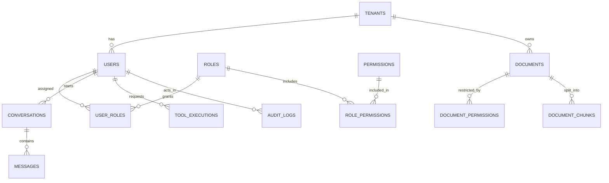

# EASA — Database Design

> **Status:** M2 foundation implemented (engine, sessions, Alembic baseline). **No domain tables exist yet.** The logical model in section 6 is a provisional design, not an implemented schema.
> Checked against the M5 state (commit `3371ec3` plus M5 changes) on 2026-11-14.

Related: [LLD](LLD.md) · [Architecture decisions](ARCHITECTURE_DECISIONS.md) · [Security](SECURITY.md)

## 1. Current state

| Item | Value |
|---|---|
| Engine | SQLite (Python's built-in `sqlite3`, SQLite 3.50.4 on the dev machine) |
| Default location | `apps/api/var/easa.db` (directory created on startup; git-ignored) |
| Tables | `alembic_version` only (created by Alembic) |
| Migration head | `7b339cea85fb` — empty baseline |
| ORM | SQLAlchemy 2.1 declarative `Base` with no models |

Tables are added only when a phase defines their requirements ([ADR-004](ARCHITECTURE_DECISIONS.md#adr-004)).

## 2. Configuration

The database URL comes from `EASA_DATABASE_URL` (or `apps/api/.env`), validated by the application `Settings`. Allowed drivers: `sqlite`, `sqlite+pysqlite`, `postgresql+psycopg`. The value is a secret string: it is not shown in `repr()` or in validation errors. The app and Alembic read the same setting; `alembic.ini` holds no URL.

## 3. Engine — [app/db/engine.py](../apps/api/app/db/engine.py)

| Setting | Value | Reason |
|---|---|---|
| `pool_pre_ping` | `True` | Detect dropped connections before use |
| SQLite `check_same_thread` | `False` | FastAPI runs synchronous handlers in a thread pool |
| SQLite parent directory | created if missing | First run works without manual setup |
| SQLite `PRAGMA foreign_keys=ON` | on every connection | SQLite does not enforce foreign keys by default; this matches PostgreSQL behaviour |

The engine is created by the application factory and disposed on shutdown.

## 4. Sessions — [app/db/session.py](../apps/api/app/db/session.py)

| Function | Use | Transaction behaviour |
|---|---|---|
| `create_session_factory(engine)` | Once per app (`app.state.session_factory`) | `autoflush=False`, `expire_on_commit=False` |
| `session_scope(factory)` | Scripts and service-level units of work | Commits on success; rolls back on any exception; always closes |
| `iter_session(factory)` / `get_db_session` | FastAPI request dependency | **Never commits implicitly**; rolls back on exception; always closes |

Services decide when to commit. Route handlers do not commit.

## 5. Migrations

- Environment: [migrations/env.py](../apps/api/migrations/env.py) loads `Settings`, uses JSON logging, compares column types (`compare_type=True`) and enables batch mode on SQLite (`render_as_batch`), because SQLite cannot `ALTER` most constraints.
- File names are date-prefixed: `YYYYMMDD_<rev>_<slug>.py`.
- New migration files are formatted and lint-fixed by ruff through two Alembic post-write hooks of type `module` (`python -m ruff` with the current interpreter), which work on Windows, Linux and macOS.
- `scripts/check.ps1` and CI apply all migrations to a temporary database and run `alembic check`.
- Migrations run manually; the app does not migrate on startup.
- Every autogenerated migration must be reviewed before it is committed.

Verified commands (from `apps/api`):

```powershell
uv run alembic upgrade head
uv run alembic current
uv run alembic check
uv run alembic downgrade base
uv run alembic upgrade head --sql
uv run alembic revision --autogenerate -m "describe change"
```

Tests confirm a single migration head, an upgrade/downgrade round trip, that only `alembic_version` exists after upgrade, and that models and migrations are in sync.

## 6. Provisional logical model (not implemented)

> **PROPOSED.** This sketch exists to keep ownership and tenant boundaries in mind. Each table will be designed, reviewed and migrated in the phase that needs it, and may change.



| Entity | Purpose | Phase |
|---|---|---|
| `tenants` | Isolation boundary, if multi-tenancy is adopted | 6 (decision pending) |
| `users`, `roles`, `permissions`, `user_roles` | Identity and RBAC (employee, manager, administrator) | 6 |
| `documents` | Uploaded file metadata, owner, tenant, processing status, content hash for idempotent ingestion | 2 |
| `document_permissions` | Which roles or users may read a document | 2 / 6 |
| `document_chunks` | Chunk text, page and section, inherited access metadata; embeddings in Phase 3 | 2 / 3 |
| `conversations`, `messages` | Chat history owned by a user | 4 / 7 |
| `tool_executions` | Tool name, arguments, requesting user, authorization result, outcome, correlation ID | 5 |
| `audit_logs` | Protected operations with actor, action, target, result, correlation ID | 5 / 6 |

## 7. Design rules for future tables

- Primary keys on every table; foreign keys for every relationship.
- Unique constraints where the domain requires uniqueness (for example, a document's content hash per tenant).
- `created_at` and `updated_at` timestamps (UTC).
- Explicit ownership and tenant columns where data belongs to someone; filters applied in the backend, never trusted from the browser.
- Indexes justified by real queries.
- Constraint names come from the naming convention below, so migrations behave the same on SQLite and PostgreSQL.
- Schema changes only through reviewed Alembic migrations.

Naming convention ([app/db/base.py](../apps/api/app/db/base.py)):

| Constraint | Pattern |
|---|---|
| Index | `ix_%(column_0_label)s` |
| Unique | `uq_%(table_name)s_%(column_0_name)s` |
| Check | `ck_%(table_name)s_%(constraint_name)s` |
| Foreign key | `fk_%(table_name)s_%(column_0_name)s_%(referred_table_name)s` |
| Primary key | `pk_%(table_name)s` |

## 8. Vector data (Phase 3, planned)

When embeddings are introduced, each stored vector will record the embedding model name, version and dimensions. Vectors from incompatible models will never share a search space without explicit versioning and a re-embedding migration.

## 9. PostgreSQL path (Phase 3, planned)

1. Install the `psycopg` driver (allowed by configuration today, not installed).
2. Point `EASA_DATABASE_URL` at PostgreSQL and run `alembic upgrade head`.
3. Add the `pgvector` extension through a migration.
4. Run the integration tests against a real PostgreSQL instance.

## 10. Data handling

Only synthetic data is stored. Database files are git-ignored (`var/`, `*.db` with its journal, WAL and SHM files, `*.sqlite`, `*.sqlite3`). There is no backup or retention policy in Phase 1 because nothing of value is stored.
