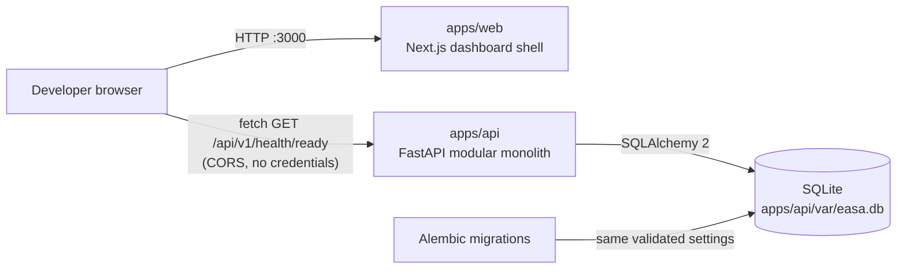
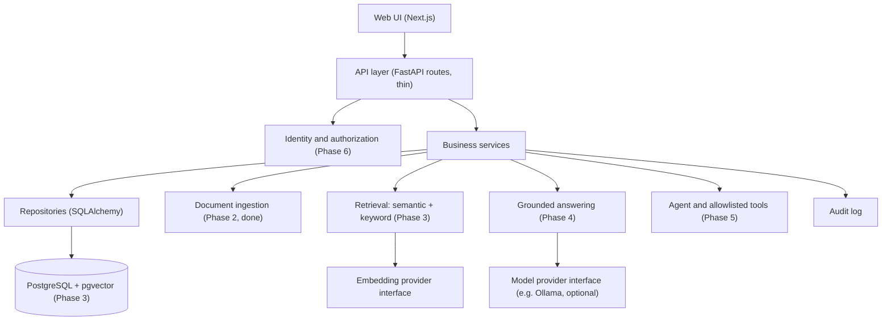

# EASA — High-Level Design

> **Status:** Phases 1 (foundation) and 2 (document intelligence) are complete; this document describes the implemented system and the target architecture.
> Last checked against the M5 state (commit `3371ec3` plus M5 changes) on 2026-11-14.
> This is a learning and portfolio project. It is **not production-ready**, and all data is synthetic.

Related documents: [LLD](LLD.md) · [Database design](DATABASE_DESIGN.md) · [API specification](API_SPECIFICATION.md) · [Security](SECURITY.md) · [Development guide](DEVELOPMENT_GUIDE.md) · [Architecture decisions](ARCHITECTURE_DECISIONS.md) · [Progress](PROGRESS.md)

## 1. Purpose

EASA (Enterprise AI Support Agent) will let authorized employees ask questions about company knowledge and receive answers grounded in approved documents, with citations, plus a small set of controlled actions (tools). Access control is enforced on the server, never in prompts or in the browser.

The project exists to demonstrate retrieval-augmented generation, document ingestion, agent tool calling, RBAC, evaluation and secure application design, built in phases.

## 2. Goals and non-goals

**Goals (whole project)**

- Grounded answers with citations from authorized documents only.
- Server-side authorization for every protected operation, including retrieval.
- Provider-independent interfaces for models, embeddings and vector storage.
- Observable behaviour: structured logs, correlation IDs, audit records, evaluation.
- Runs on a CPU-only Windows laptop without paid services.

**Non-goals**

- Production deployment, high availability or measured scale claims.
- Real company data, credentials or customer information.
- Microservices, queues or caches before requirements and measurements justify them ([ADR-001](ARCHITECTURE_DECISIONS.md#adr-001)).

## 3. Current system (Phase 1, implemented)

| Component | Technology | Implemented today |
|---|---|---|
| Web (`apps/web`) | Next.js 16 (App Router), React 19, strict TypeScript, Tailwind 4, Zod | Dashboard shell; API status card that calls readiness from the browser; every API response validated at runtime |
| API (`apps/api`) | Python 3.14, FastAPI, Pydantic Settings, SQLAlchemy 2 | Strict configuration, correlation IDs, JSON logging, standard error envelope, liveness and readiness endpoints, session management |
| Database | SQLite file (git-ignored) | `documents` and `document_chunks` (Phase 2, P2-M1); tenant-scoped repository |
| File store | Local disk, content-addressed (git-ignored) | Stores uploaded bytes by SHA-256 |
| Document API | FastAPI routes (development only) | Upload with validation and idempotency, list, get (P2-M2); in-request text extraction and normalization for PDF, DOCX and TXT (P2-M3); configurable chunking with page/section metadata and a chunks endpoint (P2-M4) |
| Migrations | Alembic | Settings-driven environment; baseline plus the documents migration |

There is **no** authentication, retrieval, model integration or tool execution yet; document endpoints use a development-only identity. Those arrive in later phases (section 6).

## 4. Target architecture (planned)

The application stays a modular monolith. Each concern below is a module behind a typed interface, so external systems can be swapped without touching business logic.

| Module | Responsibility | Status |
|---|---|---|
| API layer | HTTP contracts, validation, no business logic | Implemented (health only) |
| Core | Configuration, logging, correlation IDs, errors, middleware | Implemented |
| Services | Business rules (currently `HealthService`) | Implemented (health only) |
| Persistence | Engine, sessions, declarative base, migrations, tenant-scoped repositories, content-addressed file store | Implemented for documents and chunks |
| Identity and RBAC | Verified identity, roles, document permissions, tenant filters | Planned (Phase 6) |
| Document ingestion | Upload validation, text extraction, normalization, chunking, status tracking, resource budgets | Implemented (Phase 2) |
| Retrieval | Embeddings, vector and keyword search, authorization filters, citations | Planned (Phase 3) |
| Grounded answering | Bounded context construction, evidence-only answers, citations | Planned (Phase 4) |
| Agent and tools | Typed tool contracts, allowlist, approvals, audit | Planned (Phase 5) |
| Audit | Records of protected operations and tool executions | Planned |

## 5. Key flows

### 5.1 Readiness check (implemented)

1. The browser loads the dashboard from the web server.
2. The API status card calls `GET /api/v1/health/ready` directly on the API (CORS allows only configured origins; no cookies are sent).
3. The API generates a correlation ID, runs `SELECT 1` through a database probe and returns `200 ready` or `503 not_ready`.
4. The web client validates the body with Zod and shows ready, not ready or an error with the correlation ID.

Detailed sequence diagrams are in the [LLD](LLD.md#5-sequence-diagrams).

### 5.2 Question answering (planned)

Identity is resolved from a verified authentication context → authorized chunks are retrieved with permission and tenant filters applied in the backend → a bounded context is built that treats retrieved text as untrusted data → the model answers from evidence or says evidence is insufficient → citations are returned and the interaction is audited.

## 6. Phase roadmap

| Phase | Theme | Status |
|---|---|---|
| 1 | Foundation and architecture | M0–M5 done; CI passing; awaiting phase review |
| 2 | Document intelligence | Complete (P2-M1 to P2-M5); security-reviewed |
| 3 | Embeddings and retrieval (PostgreSQL + pgvector) | In progress (P3-M1 embeddings done) |
| 4 | Grounded RAG answering | Not started |
| 5 | Agent and controlled tool calling | Not started |
| 6 | Authentication and RBAC | Not started |
| 7 | Frontend and integration | Not started |
| 8 | Evaluation, reliability and delivery | Not started |

Milestone status and commit hashes: [PROGRESS.md](PROGRESS.md).

## 7. Constraints

- Windows 11 company laptop with installation restrictions; no administrator rights; no system-level installs.
- CPU-only inference baseline; no CUDA assumptions.
- Python 3.14 and Node.js 24.13 as installed; dependencies must be compatible with them ([ADR-012](ARCHITECTURE_DECISIONS.md#adr-012)).
- No paid services or API keys. PostgreSQL, Ollama and Docker are not used in Phase 1.

## 8. Quality attributes

| Attribute | Approach |
|---|---|
| Security | Deny by default, server-side checks, strict config, safe errors, minimal exposure. See [SECURITY.md](SECURITY.md) |
| Observability | JSON logs with a server-generated correlation ID on every request ([ADR-006](ARCHITECTURE_DECISIONS.md#adr-006)) |
| Maintainability | Small modules, typed interfaces, dependency inversion at external boundaries |
| Testability | App factory, injected dependencies, deterministic tests (285 automated tests today) |
| Portability | SQLAlchemy and Alembic abstractions so PostgreSQL can replace SQLite ([ADR-003](ARCHITECTURE_DECISIONS.md#adr-003)) |

## 9. Risks

| Risk | Mitigation |
|---|---|
| New major versions on a restricted machine (Python 3.14, Node 24.13) | Check wheel and engine compatibility before adding packages; pin compatible versions |
| Documentation drifting from code | Documents state the commit they were checked against; [PROGRESS.md](PROGRESS.md) records verification per milestone |
| Public, unauthenticated health endpoints | They return only coarse status; revisit when deployment is considered |
| Prompt injection and data leakage in later phases | Authorization before retrieval, retrieved text treated as data, allowlisted tools (Phases 3–6) |
