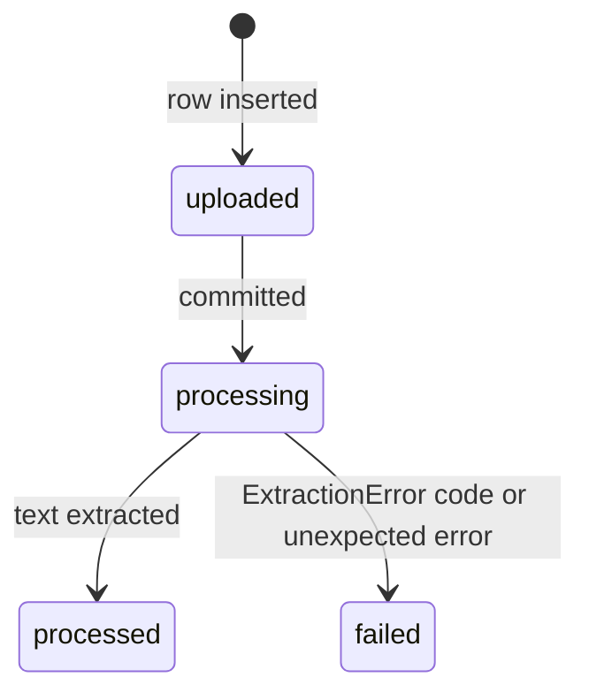
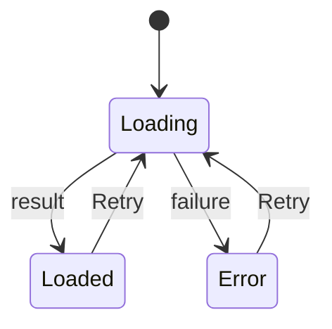
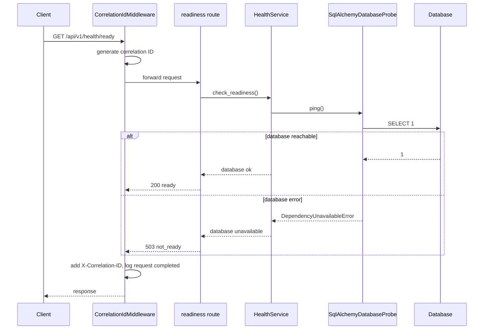
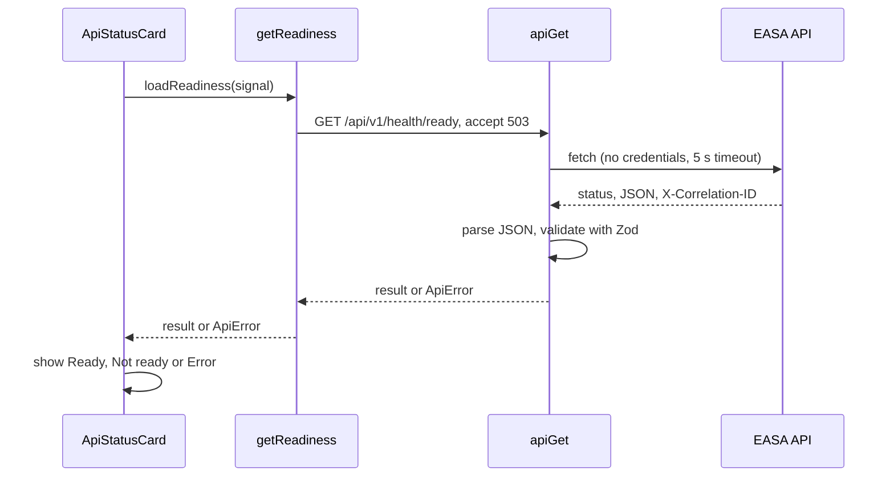

# EASA — Low-Level Design

> **Status:** describes the code as of M5 (commit `3371ec3` plus M5 changes), checked 2026-11-14. Planned work is labelled as such.

Related: [HLD](HLD.md) · [API specification](API_SPECIFICATION.md) · [Database design](DATABASE_DESIGN.md) · [Architecture decisions](ARCHITECTURE_DECISIONS.md)

## 1. Repository layout

```
easa/
  apps/api/                FastAPI backend (Python 3.14, uv)
    app/
      main.py              application factory: create_app()
      core/                config, correlation IDs, logging, errors, middleware, identity
      api/                 dependencies.py, v1/router.py, v1/routes/ (health, documents, search, answers,
                           conversations, tools, agent)
      services/            health.py (HealthService, DatabaseProbe protocol),
                           uploads.py (upload validation), documents.py (DocumentService)
      schemas/             health.py, documents.py (response models)
      db/                  engine.py, session.py, base.py, models.py, probe.py,
                           types.py (UtcDateTime), documents.py (Document, DocumentChunk),
                           embeddings.py (ChunkEmbedding), fts.py (FTS5 keyword index DDL)
      repositories/        documents.py (tenant-scoped DocumentRepository), embeddings.py
      tools/               base.py (Tool contract), registry.py (allowlist), executor.py,
                           support.py (ticket and knowledge tools), seed.py (Phase 5)
      llm/                 base.py (ChatModel protocol), fake.py, http.py, llamacpp.py, ollama.py,
                           registry.py (pinned GGUF), factory.py (Phase 4)
      embeddings/          base.py (Embedder protocol), registry.py (pinned models), onnx.py,
                           hashing.py (test embedder), factory.py (provider + download)
      retrieval/           base.py (VectorIndex, KeywordIndex protocols), brute_force.py (exact search),
                           pgvector_index.py (PostgreSQL), keyword.py (FTS5 and PostgreSQL
                           full-text search), hybrid.py (reciprocal rank fusion), factory.py
      evaluation/          dataset.py, metrics.py, runner.py, report.py, hnsw.py (P3-M5)
      storage/             blob_store.py (BlobStore protocol, LocalBlobStore)
    eval/                  synthetic evaluation corpus (corpus/*.txt) and labelled queries.json
    migrations/            Alembic env.py, script template, versions/
    tests/                 unit/, integration/, model/ (real embedding model), postgres/
    alembic.ini, pyproject.toml, uv.lock, .env.example
  apps/web/                Next.js frontend
    src/app/               layout.tsx, page.tsx, globals.css
    src/components/        health/ApiStatusCard.tsx, layout/AppHeader.tsx, layout/SideNav.tsx
    src/lib/               config.ts, api/client.ts, api/schemas.ts, api/health.ts
    vitest.config.mts, vitest.setup.ts, next.config.ts, package.json, .env.example
  docs/                    this documentation set and PROGRESS.md
  compose.yaml             local PostgreSQL 18 + pgvector (optional; P3-M4)
  scripts/                 check.ps1 (all checks), dev.ps1 (run both servers)
  .github/workflows/       ci.yml (GitHub Actions: API and web jobs)
```

## 2. Backend (`apps/api`)

### 2.1 Layers and dependency direction

```
routes (app/api)  ->  services (app/services)  ->  ports (Protocols in services)
                                                      ^
                          adapters (app/db/probe.py) -+
core (app/core) is used by every layer; it depends on no business code.
```

Routes stay thin: they resolve dependencies, call a service and map the result to a response schema. Services define the interfaces (ports) they need; adapters in `app/db` implement them. This is how `HealthService` depends on a `DatabaseProbe` protocol instead of SQLAlchemy ([ADR-008](ARCHITECTURE_DECISIONS.md#adr-008)).

### 2.2 Application factory — [app/main.py](../apps/api/app/main.py)

`create_app(settings: Settings | None = None) -> FastAPI`:

1. Loads `Settings` (or uses the ones passed in, which is how tests isolate configuration).
2. Calls `configure_logging(settings.log_level)`.
3. Creates the engine with `create_db_engine(...)`; a lifespan handler disposes it on shutdown.
4. Builds `FastAPI(title="EASA API", version="0.1.0")`. `/docs` and `/openapi.json` are `None` (disabled) when `environment == "production"`; ReDoc is always disabled.
5. Stores `settings`, `engine`, `session_factory` and `blob_store` (a `LocalBlobStore` rooted at `settings.storage_dir`) on `app.state`.
6. Registers exception handlers and includes the `/api/v1` router.
7. Adds middleware (see 2.4).

Run with `uv run uvicorn app.main:create_app --factory --no-proxy-headers` so configuration is read at startup, not at import time, and so that Uvicorn does not rewrite the client address from `X-Forwarded-For` (proxy trust is the API's `trusted_proxies` setting; ADR-035).

### 2.3 Configuration — [app/core/config.py](../apps/api/app/core/config.py)

`Settings(BaseSettings)` with `env_prefix="EASA_"`, `env_file=".env"` (relative to the working directory), `extra="forbid"`, `frozen=True`, `hide_input_in_errors=True` ([ADR-005](ARCHITECTURE_DECISIONS.md#adr-005)).

| Field | Type | Default | Validation |
|---|---|---|---|
| `environment` | `"development" \| "test" \| "production"` | `development` | Literal |
| `log_level` | `DEBUG`…`CRITICAL` | `INFO` | Literal |
| `database_url` | `SecretStr` | `sqlite:///<apps/api>/var/easa.db` | Parsed with SQLAlchemy `make_url`; driver must be `sqlite`, `sqlite+pysqlite` or `postgresql+psycopg` |
| `cors_allowed_origins` | `list[str]` (JSON in env) | `["http://localhost:3000"]` | Each origin `http(s)://host[:port]`; no `*`, path, query or fragment; trailing `/` removed |
| `rate_limit_login_per_minute`, `rate_limit_model_per_minute` | `int` | `20`, `10` | 0–10000; `0` turns the limit off (P8-M1) |
| `trusted_proxies` | `list[str]` (JSON in env) | `[]` | Each must be an IP address; surrounding spaces removed |

`is_production` is a convenience property. Validation errors never echo input values.

### 2.4 Middleware chain — [app/core/middleware.py](../apps/api/app/core/middleware.py)

Starlette runs the last-added middleware first. Effective order for a request, outermost first (FastAPI 0.162 also inserts `ExceptionTelemetryMiddleware` after #1 and `AsyncExitStackMiddleware` after #5; both are framework pass-through layers):

| # | Layer | Behaviour |
|---|---|---|
| 1 | Starlette `ServerErrorMiddleware` | Framework fallback (rarely reached; see #4) |
| 2 | `CorrelationIdMiddleware` | Generates `uuid4().hex` per HTTP request, stores it in a context variable, adds `X-Correlation-ID` to the response, logs `request completed` with `method`, `path`, `status_code`, `duration_ms` (query string deliberately omitted) |
| 2a | `SecurityHeadersMiddleware` (P8-M1) | Adds the security headers of API_SPECIFICATION section 4 to every response start, including errors and CORS rejections; no CSP or `no-store` for `/docs` and `/openapi.json`; HSTS when `hsts=settings.is_production` |
| 3 | `CORSMiddleware` | Allowed origins from settings; `allow_methods=["GET"]`, `allow_headers=["Content-Type"]`, `allow_credentials=False`, exposes `X-Correlation-ID` |
| 4 | `UnhandledErrorMiddleware` | Catches any exception from the app, logs it with traceback, returns the standard 500 body. If the response had already started it re-raises |
| 4a | `BodySizeLimitMiddleware` | Rejects a declared `Content-Length` over `max_upload_bytes + 64 KiB` before reading; otherwise counts body bytes as they arrive and, if the limit is crossed, replaces the app's response with `413 request_too_large`. Malformed `Content-Length` → `400 invalid_content_length` |
| 5 | Starlette `ExceptionMiddleware` | Runs the registered exception handlers (2.5) |
| 6 | Router | `/api/v1/health`, `/api/v1/health/ready`; outside production also `/api/v1/documents` routes |

Because #4 sits inside #2 and #3, an unexpected error still returns a response carrying CORS headers and the correlation ID ([ADR-007](ARCHITECTURE_DECISIONS.md#adr-007)).

**Rate limits (P8-M1, ADR-035)** — [app/core/rate_limit.py](../apps/api/app/core/rate_limit.py): `RateLimiter(limit, window=60, clock)` keeps a deque of event times per key under a lock; `check(key)` returns `None` (allowed and recorded) or the seconds until the oldest event leaves the window; `limit <= 0` allows everything; at `MAX_KEYS` (10,000) idle keys are evicted, otherwise the least recently used one. `too_many_requests(retry_after)` is the `429 rate_limited` error with `Retry-After` rounded up. `client_address(request, trusted_proxies)` is the peer, or for a trusted peer the rightmost valid `X-Forwarded-For` address that is not itself trusted (malformed: the peer). `create_app` stores `login_limiter` and `model_limiter` on `app.state`. The route dependencies in [dependencies.py](../apps/api/app/api/dependencies.py) are `limit_sign_in` (key `login:<address>`, on `POST /auth/login`) and `limit_model_calls` (key `model:<tenant>:<user>`, after authentication, on `POST /answers`, `POST /conversations/{id}/messages` and `POST /agent`).

### 2.5 Errors — [app/core/errors.py](../apps/api/app/core/errors.py)

Response shape: `{"error": {"code", "message", "correlation_id", "details"?}}` (`details` omitted when empty).

| Exception | Status | `code` | `message` |
|---|---|---|---|
| `AppError(message, code=..., status_code=...)` | given | given | given (must be client-safe) |
| Starlette `HTTPException` (e.g. unknown route, wrong method) | its status | HTTP reason phrase in snake case (`not_found`, `method_not_allowed`) | `detail` if a string, else the reason phrase; exception headers (e.g. `Allow`) preserved |
| `RequestValidationError` | 422 | `validation_error` | `Request validation failed.`; `details` = `[{location, message, type}]`, never the submitted values |
| Any other exception | 500 | `internal_error` | `An unexpected error occurred.` |

### 2.6 Logging — [app/core/logging.py](../apps/api/app/core/logging.py)

`configure_logging(level)` installs one JSON handler on the root logger (stderr), removes Uvicorn's own handlers so `uvicorn` and `uvicorn.error` propagate to it, and raises `uvicorn.access` to `WARNING` (request logging is done by the middleware). `JsonFormatter` emits `timestamp` (UTC, milliseconds), `level`, `logger`, `message`, `correlation_id` (null outside a request), any `extra=` fields and `exception` when present. Uvicorn's ANSI `color_message` duplicate is dropped.

With `--reload`, the reloader supervisor process logs in plain text because it runs before the factory configures logging; the worker's logs are JSON.

### 2.6a Documents — routes, service, validation (P2-M2)

- [routes/documents.py](../apps/api/app/api/v1/routes/documents.py): `upload_document` (multipart field `file`; `201` new, `200` existing, `Location` header), `list_documents` (`limit` 1–200, `offset` ≥ 0), `get_document`, `list_document_chunks` (`limit` 1–500, default 100). Handlers only resolve dependencies, call the service and map to `DocumentResponse`. Mounted in `create_app` only when not in production.
- [dependencies.py](../apps/api/app/api/dependencies.py): `get_identity` resolves the `Authorization: Bearer` token through `AuthService.authenticate` in its own short session (section 2.6n); `get_document_service` wires the request session, `app.state.blob_store` and `max_upload_bytes`.
- [services/uploads.py](../apps/api/app/services/uploads.py): `sanitize_filename` and `validate_upload` → `ValidatedUpload(filename, media_type)` or `UploadRejectedError` (an `AppError` with a specific code and status). `DocxLimits` holds the zip-bomb limits.
- [services/documents.py](../apps/api/app/services/documents.py): `DocumentService.upload` validates, hashes, returns the existing document for known content, otherwise stores the blob **then** inserts the row and commits (an orphan blob is harmless; a row without a blob is not). A unique-constraint race with a concurrent identical upload is resolved by returning the winner. `get` raises `DocumentNotFoundError` (404) for missing and foreign documents alike.

### 2.6b Processing — extraction and normalization (P2-M3)

`DocumentService.upload` calls `_process` for every newly created document (identical re-uploads are not reprocessed):



- [services/extraction.py](../apps/api/app/services/extraction.py) `extract_document(media_type, data, max_pdf_pages)` returns an `ExtractionResult`: ordered `TextBlock`s (`text`, `kind`, `page_number`, `section`) plus `page_count`. `ExtractionResult.text` joins blocks with a blank line; this canonical text is what chunk offsets (P2-M4) refer to.
  - **PDF** (`pypdf`): rejects encrypted files and files over the page limit, then one `page` block per page that has text (1-based `page_number`; text-less pages are skipped but counted). `PdfReadError` → `corrupt_file`.
  - **DOCX** (`python-docx`): walks paragraphs and tables in document order. `Title`/`Heading*` paragraphs become `heading` blocks and set the current `section`; paragraphs and tables (cells joined with ` | `, rows with newlines) inherit it. Any exception from opening the package → `corrupt_file`.
  - **TXT**: UTF-8 (BOM removed), split into `paragraph` blocks at blank lines.
  - No blocks at all → `no_extractable_text`.
  - **Budgets (P2-M5)**, enforced while blocks are produced by a `_Budget`: 5,000,000 characters including separators (`text_too_large`) and 50,000 blocks (`document_too_complex`); DOCX table text is checked against the remaining budget cell by cell.
  - **PDF limits (P2-M5)**: parsing runs inside `pypdf.apply_configuration(...)` with stream output limits of 20 MB (instead of 75 MB), at most 50 MB decoded per document, and a 30-second budget checked between pages; `LimitReachedError` → `resource_limit_exceeded`, other `PyPdfError` → `corrupt_file`. `pypdf`'s logger is set to ERROR.
  - **DOCX details (P2-M5)**: style names are resolved once per document (`Paragraph.style` did an XPath search per paragraph); table cells are read once per physical `<w:tc>`, ignoring `gridSpan`.
- [services/normalization.py](../apps/api/app/services/normalization.py) `normalize_text`: NFC; `\r\n`/`\r` → `\n`; zero-width characters and BOM removed; all other whitespace except newlines → single spaces; control characters removed; lines trimmed; hyphenated line breaks between lowercase letters joined (`infor-\nmation` → `information`); three or more newlines → two. Deterministic and idempotent.
- [services/chunking.py](../apps/api/app/services/chunking.py) `chunk_document(result, ChunkingConfig)` (P2-M4) returns `Chunk`s whose text is always exactly `result.text[char_start:char_end]`, trimmed of surrounding whitespace, at most `max_chars` long:
  - `fixed`: windows of up to `max_chars` over the whole text. A cut is placed after the last newline, else the last space, within the final 20% of the window (else at the limit); the next window starts `overlap_chars` back, moved forward to a word boundary.
  - `structured` (default): whole blocks are merged until the next block would exceed `max_chars`. A heading always starts a new chunk; a change of page or section ends one; a single block longer than `max_chars` is split with the `fixed` windows.
  - Each chunk takes `page_number` and `section` from the block where it starts, found by binary search over block end offsets (`bisect`), so chunking is O(chunks · log blocks). More than 20,000 chunks → `document_too_complex`. `ChunkingConfig` validates `max_chars >= 100` and `0 <= overlap_chars < max_chars / 2` (mirrored in `Settings`).
- Outcome handling: chunks are written with `replace_chunks` in the same transaction as the final status. `ExtractionError` → `failed` with its code; any other exception (parsing or chunking) → rollback of partial chunks, logged with traceback, `failed` with `processing_error`; success → `processed`, `page_count` and `chunking_config`. One `document processed` log line per document with metadata only (block and chunk counts, never text).
- Unexpected failures are logged at ERROR with the exception type only; the traceback goes to DEBUG (it can quote file content).
- Interrupted documents: an identical re-upload of a document still `uploaded`/`processing` whose `updated_at` is older than `STALE_PROCESSING_AFTER` (10 minutes) runs `_process` again with the uploaded bytes.
- `DocumentService.list_chunks` first resolves the document for the tenant (404 otherwise), then returns a page of chunks and the total count.

### 2.6c Embeddings (P3-M1)

- [embeddings/base.py](../apps/api/app/embeddings/base.py): the `Embedder` protocol (`model_id`, `dimensions`, `is_available()`, `embed(texts)` returning an L2-normalized float32 array of shape `(n, dimensions)`) and `EmbeddingUnavailableError`.
- [embeddings/registry.py](../apps/api/app/embeddings/registry.py): `EmbeddingModelSpec` and the default model, `bge-small-en-v1.5`: repo `Qdrant/bge-small-en-v1.5-onnx-Q`, revision `aa8f8b06…`, 384 dimensions, MIT licence, an explicit file list. `model_id` = `name@revision[:12]`.
- [embeddings/onnx.py](../apps/api/app/embeddings/onnx.py) `OnnxEmbedder`: loads fastembed `TextEmbedding` lazily (thread-safe) from `<EASA_EMBEDDING_MODEL_DIR>/<name>/<revision>` with `specific_model_path` and `local_files_only=True`, so it never downloads at runtime. Missing files raise `EmbeddingUnavailableError`.
- [embeddings/hashing.py](../apps/api/app/embeddings/hashing.py) `HashingEmbedder` (`hashing-v1-384`): **not semantic**. A signed bag of hashed word tokens; deterministic and offline, for tests, CI and development without the model.
- [embeddings/factory.py](../apps/api/app/embeddings/factory.py): `build_embedder(settings)` (`EASA_EMBEDDING_PROVIDER` = `onnx` | `hashing`) and `download_model()` (`huggingface_hub.snapshot_download` at the pinned revision, allowed files only).
- [services/embedding_service.py](../apps/api/app/services/embedding_service.py) `EmbeddingService`: `embed_chunks` (batches of `EASA_EMBEDDING_BATCH_SIZE`; checks the result shape; stores and commits) and `embed_missing` (backfill across tenants, for the CLI only).
- [repositories/embeddings.py](../apps/api/app/repositories/embeddings.py): `add`, `chunks_without_embedding(model_id)` (chunks of processed documents only), `vectors_for_document(tenant_id, …)`; float32 encoding and decoding with a dimension check.
- Processing: after a document commits as `processed`, `DocumentService._embed` embeds its chunks as a separate unit of work. A failure is rolled back and logged as `document embedding skipped` (with the error type), and the document stays `processed`.
- `app.state.embedder` is built at startup (model loaded on first use) and is also the readiness probe (`checks.embeddings`).
- [cli.py](../apps/api/app/cli.py): `python -m app.cli download-embedding-model`, `python -m app.cli embed-missing [--limit N]` and `python -m app.cli rebuild-keyword-index` (section 2.6e).

### 2.6d Semantic search (P3-M2) and search modes (P3-M3)

- [retrieval/base.py](../apps/api/app/retrieval/base.py): the `VectorIndex` protocol, `search(tenant_id, model_id, query_vector, top_k) -> [ScoredChunk(chunk_id, score)]`. Implementations must filter by tenant, processed status and model **before** scoring.
- [retrieval/brute_force.py](../apps/api/app/retrieval/brute_force.py) `BruteForceVectorIndex`: one SQL query joins `chunk_embeddings` → `document_chunks` → `documents`, filtered by `model_id`, `tenant_id` (on both the vector and the document) and `status = processed`. Rows are streamed in batches of 5,000 (`yield_per`), so memory is bounded by the batch size, and each batch is scored with one matrix-vector product. A running top-k is kept; ties are broken by chunk ID so results are deterministic and independent of batch size. Works on any SQL backend; exact.
- [services/search.py](../apps/api/app/services/search.py) `SearchService(session, embedder, index, keyword_index).search(identity, query, *, top_k, mode=semantic)`: normalizes the query like chunk text; rejects empty (`empty_query`) or out-of-range input; returns `503 embeddings_unavailable` when the model is missing (not in `keyword` mode, which needs no embedder). Per mode:
  - `semantic`: embeds the query with `Embedder.embed_query` (fastembed's query handling for the ONNX model) and asks the `VectorIndex`.
  - `keyword`: asks the `KeywordIndex` protocol (`search(tenant_id, query, top_k)`); `model_id` in the result is `None`.
  - `hybrid`: takes `max(4 × top_k, 20)` candidates (`MIN_HYBRID_CANDIDATES`) from both rankings and fuses them with reciprocal rank fusion.

  It then loads chunk and document details in one tenant-scoped query (`DocumentRepository.chunks_with_documents`), skipping chunks deleted in between. It logs mode, model ID, `top_k`, result count and duration, never the query.
- [routes/search.py](../apps/api/app/api/v1/routes/search.py): `POST /api/v1/search` (`SearchRequest` forbids unknown fields; `mode` is a `SearchMode` enum) → `SearchResponse` (`mode`, nullable `model_id`) with a `Citation` per hit. Mounted only outside production, next to the document routes. `get_search_service` gets the indexes for the request session from `build_indexes` (section 2.6f).

### 2.6e Keyword and hybrid retrieval (P3-M3)

- [db/fts.py](../apps/api/app/db/fts.py): `KEYWORD_INDEX_DDL` (the external-content FTS5 table `chunk_fts` plus insert, delete and update triggers on `document_chunks`), `create_keyword_index`, `rebuild_keyword_index` and `is_keyword_index_object` (used by the Alembic `include_name` filter). The migration `6d544dac46b3` contains the same statements; a test compares the two. See [DATABASE_DESIGN.md section 8.1](DATABASE_DESIGN.md#81-keyword-index-phase-3-implemented-in-p3-m3).
- [retrieval/keyword.py](../apps/api/app/retrieval/keyword.py):
  - `build_match_query(query)`: lower-cases, extracts `\w+` tokens, removes duplicates, keeps at most `MAX_QUERY_TERMS` (32), quotes each token and joins them with `OR`. Returns `None` when there are no tokens. User text never reaches FTS5 query syntax directly.
  - `SqliteKeywordIndex.search(tenant_id, query, top_k)`: one SQL query joins `chunk_fts` → `document_chunks` (by `rowid`) → `documents`, filtered by tenant (on both the chunk and the document) and `status = processed`, ordered by `bm25()` then chunk ID. The score is `-bm25` (higher is better). On a database other than SQLite it raises `503 keyword_search_unavailable`.
- [retrieval/hybrid.py](../apps/api/app/retrieval/hybrid.py) `reciprocal_rank_fusion(rankings, *, top_k, k=60)`: each chunk scores `Σ 1 / (k + rank)` over the rankings it appears in (rank starts at 1). Only positions matter, so BM25 and cosine scores never need to be put on one scale. Ties are broken by chunk ID.

### 2.6f PostgreSQL retrieval (P3-M4)

- [db/types.py](../apps/api/app/db/types.py) `EmbeddingVector`: a `TypeDecorator` whose Python value is always float32 little-endian `bytes`. `load_dialect_impl` returns `LargeBinary` on SQLite and pgvector's `VECTOR()` (no dimension) on PostgreSQL; bind and result processing convert bytes to and from NumPy arrays on PostgreSQL only. Repositories and `BruteForceVectorIndex` work unchanged on both backends. Alembic renders the type as `sa.LargeBinary()`; the PostgreSQL migration converts the column.
- [retrieval/pgvector_index.py](../apps/api/app/retrieval/pgvector_index.py) `PgvectorIndex.search(tenant_id, model_id, query, top_k)`: one SQLAlchemy query selecting `chunk_id` and `vector <=> CAST(:query_vector AS VECTOR)`, joined to chunks and documents, filtered by model, tenant (vector and document), processed status and `dimensions = len(query)`, ordered by distance then chunk ID, limited to `top_k`. Score = `1 - distance`. No ANN index, so results are exact.
- [retrieval/keyword.py](../apps/api/app/retrieval/keyword.py): `query_terms` (shared token extraction); `build_tsquery` quotes each token and joins with ` | `. `PostgresKeywordIndex` runs `POSTGRES_KEYWORD_SQL`: `to_tsquery('english', :match)` cross-joined once, `to_tsvector('english', dc.text) @@ query` (the GIN index expression), tenant and status filters, `ORDER BY ts_rank_cd(...) DESC, dc.id`. Each implementation raises `503 keyword_search_unavailable` on the other backend.
- [retrieval/factory.py](../apps/api/app/retrieval/factory.py) `build_indexes(session)`: `(PgvectorIndex, PostgresKeywordIndex)` on PostgreSQL, `(BruteForceVectorIndex, SqliteKeywordIndex)` otherwise.

### 2.6g Retrieval evaluation (P3-M5)

See [EVALUATION.md](EVALUATION.md) for method and results.

- [evaluation/dataset.py](../apps/api/app/evaluation/dataset.py): `load_dataset()` reads `eval/corpus/*.txt` and `eval/queries.json` into `Dataset(documents, queries)`; `validate_dataset` reports duplicate IDs, unknown categories or documents, and evidence phrases that are not normalized single lines, do not occur exactly once in their document, or also occur in another document.
- [evaluation/metrics.py](../apps/api/app/evaluation/metrics.py): `evidence_ranks(ranked_texts, evidence)` (1-based rank of the first chunk containing each phrase), `recall_at_k`, `reciprocal_rank`, `mean`.
- [evaluation/runner.py](../apps/api/app/evaluation/runner.py) `run_evaluation(dataset, embedder, *, backend, database, configs)`: per `EvalConfig` (strategy, max_chars, overlap 150), a fresh database from the `database` factory (`sqlite_database` or `postgres_database(admin_url)`, which creates and drops `easa_eval_<random>`), `upgrade_to_head`, upload through `DocumentService`, a check that every chunk has a vector, then every query in every `SearchMode` through `SearchService` (top 10). `EvaluationReport.summary()` gives R@1/3/5/10, MRR@10 and mean latency per config, mode and category.
- [evaluation/report.py](../apps/api/app/evaluation/report.py): JSON (every outcome) and Markdown tables.
- [evaluation/hnsw.py](../apps/api/app/evaluation/hnsw.py) `run_hnsw_benchmark`: loads synthetic vectors with `COPY` (pgvector's psycopg adapter), measures exact search with `PgvectorIndex`, builds a partial HNSW expression index and measures recall and latency for four `ef_search` / `iterative_scan` settings, recording whether `EXPLAIN` shows the index.
- [evaluation/manifest.py](../apps/api/app/evaluation/manifest.py) (P8-M4, ADR-038): `file_digests(root)` (SHA-256 per file under `eval/`, the manifest excluded), `load_manifest`, `manifest_sha256`, `check_manifest(root)` (listed but missing, not listed, changed), `write_manifest(version, root)` (the version must rise). [evaluation/run_info.py](../apps/api/app/evaluation/run_info.py): `RunInfo` (evaluation, start, end, duration, data version, manifest SHA-256, Git commit with `-dirty`, Python, models, settings), `run_info(...)`, `git_commit()` (the resolved `git`, fixed arguments; `None` without Git), and `with_run_info(files, run)`, which puts `run` first in the JSON and adds a block under the Markdown title. `metrics.median_tokens` / `format_tokens` are used by the answer, agent and access reports. The CLI checks the manifest before every evaluation command. `_write(..., run)` adds the run to every report. `evaluate-all` calls `main()` for each step, skips the steps whose prerequisites are missing and writes `<stamp>-all.md`.
- [db/migrate.py](../apps/api/app/db/migrate.py) `upgrade_to_head(url)`: runs Alembic with the URL in `config.attributes["database_url"]`; `env.py` uses it instead of the settings URL and leaves logging to the caller.
- [evaluation/answers_eval.py](../apps/api/app/evaluation/answers_eval.py) (P4-M5): `AnswerCase` (kind, turns, expected document, fact alternatives, forbidden injected content), `load_answer_cases`, `load_adversarial_documents`, `validate_answer_cases`, `score` (outcomes `correct`, `wrong_citation`, `wrong`, `refused`, `corrected`, `accepted`, `answered`, `injected`, `error`) and `run_answer_evaluation`: per `AnswerEvalConfig` (chunking + `top_k`) a fresh database with the corpus and the adversarial documents, every case through `AnswerService` at temperature 0 (follow-ups with history), and the support check scored offline on the same replies. `summarize` gives per-kind correctness, outcome counts, injections, median latency and citation precision.
- [evaluation/agent_eval.py](../apps/api/app/evaluation/agent_eval.py) (P5-M5): `AgentCase` (kind, message, expected tools, fact alternatives, forbidden content, optional permissions), `load_agent_cases` (also returns the listed documents), `validate_agent_cases`, `score` (success, right tool, leaked, unnecessary proposal) and `run_agent_evaluation`: one fresh database with the seeded tickets and the listed documents, every task through `AgentService` as the evaluation identity (or with the task's permissions), **nothing confirmed**; afterwards the ticket count and the number of `create_draft_ticket` audit records with outcome `succeeded` are recorded as safety invariants. `summarize_agent` gives per-kind success, right-tool rate, unnecessary proposals, leaks, statuses and median latency.
- [evaluation/access_eval.py](../apps/api/app/evaluation/access_eval.py) (P6-M5): `AccessDocument` (path, minimum role, canaries), `AccessQuestion` (level, facts), `load_access_dataset`, `validate_access_dataset` (canaries present, unique to their document, absent from questions), `RecordingModel` (keeps everything the model is shown) and `run_access_evaluation`: one fresh database with the documents uploaded at their levels, then every role asks every question through search (hybrid, top 10), `AnswerService` and `AgentService`; a leak is a citation of a document above the role, or one of its canaries in the output or in the model's input. `summarize_access` gives leaks and facts found where permitted per surface and role.
- CLI: `evaluate-access [--backend sqlite|postgres] [--surfaces all|search]` (search needs no model), `evaluate-agent [--limit N]` (needs a configured, available chat model; same timeout rule), `evaluate-answers [--configs default|all] [--limit N]` (needs a configured, available chat model; raises the model timeout to at least 300 s), `evaluate [--backend sqlite|postgres] [--configs default|all] [--output-dir]` and `evaluate-hnsw [--vectors] [--tenants] [--queries] [--noise]`; PostgreSQL URL from `EASA_EVAL_POSTGRES_URL`.

### 2.6h Chat models (P4-M1)

- [llm/base.py](../apps/api/app/llm/base.py): `ChatMessage(role, content)`, `ChatResult(text, model_id, prompt_tokens, completion_tokens)`, the `ChatModel` protocol (`model_id`, `is_available()`, `generate(messages, *, max_tokens, temperature)`), and two errors: `ModelUnavailableError` (server unreachable or model not installed) and `ModelResponseError` (timeout, error status, malformed reply). Error messages never contain prompt or reply text, and adapters do not chain driver exceptions.
- [llm/fake.py](../apps/api/app/llm/fake.py) `FakeChatModel(reply, *, available)`: a fixed reply or a function of the messages; records every call. Configurable as `EASA_MODEL_PROVIDER=fake` outside production.
- [llm/ollama.py](../apps/api/app/llm/ollama.py) `OllamaChatModel(base_url, model, *, timeout_seconds, transport=None)`: `POST /api/chat` with `stream: false` and `options.temperature` / `options.num_predict`; reply text capped at 20,000 characters; token counts from `prompt_eval_count` / `eval_count`. `httpx.Client` with `trust_env=False` (no proxies), no redirects, a 5-second connect timeout. `404` → `ModelUnavailableError`; transport errors → `ModelUnavailableError`; timeouts, other statuses and malformed JSON → `ModelResponseError`. `is_available()` calls `GET /api/tags` with a 2-second timeout and accepts the model name with or without `:latest`. Tests use `httpx.MockTransport`.
- [llm/http.py](../apps/api/app/llm/http.py) (P4-M3): shared client rules and `post_json`, which maps transport errors and `404`/`503` to `ModelUnavailableError` and timeouts, other statuses and invalid JSON to `ModelResponseError`. Both HTTP adapters use it.
- [llm/llamacpp.py](../apps/api/app/llm/llamacpp.py) `LlamaCppChatModel` (P4-M3): `POST /v1/chat/completions` (OpenAI-compatible, `stream: false`, `max_tokens`, `temperature`); token counts from `usage`; `is_available()` requires `GET /health` = `200` (not `503` while loading) and the configured name in `GET /v1/models`.
- [llm/registry.py](../apps/api/app/llm/registry.py) (P4-M3): `ChatModelFile` (alias, Hugging Face repo, file name, 40-character revision, SHA-256, size, licence); `DEFAULT_CHAT_MODEL` = Qwen2.5 1.5B Instruct Q4_K_M; `download_chat_model` (`hf_hub_download` at the pinned revision) and `verify_model_file` (size and SHA-256, raising `ModelFileError`). CLI: `python -m app.cli download-chat-model`.
- [llm/factory.py](../apps/api/app/llm/factory.py) `build_chat_model(settings)`: `None` for `none`. `create_app` stores it as `app.state.chat_model` and closes the model's HTTP client on shutdown.

### 2.6i Grounded answers (P4-M2)

- [services/answers.py](../apps/api/app/services/answers.py) `AnswerService(retriever, model, *, max_output_tokens, temperature, context_chars=6000).answer(identity, question, *, top_k=5)`:
  1. No model configured → `503 answers_unavailable`; `top_k` outside 1–10 → `422`; default `top_k` 3 (ADR-027).
  2. `retriever.search(..., mode=HYBRID)` (the `Retriever` protocol; `SearchService` in the app). No hits → `insufficient_evidence` / `no_results`, and the model is not called.
  3. `build_sources`: labels `S1`…`Sn` in rank order until the 6,000-character budget is used; a source that does not fit is cut (keeping at least 200 characters) and ends with ` ...`.
  4. `build_messages`: a fixed `SYSTEM_PROMPT`, and `ANSWER_REMINDER` repeated after the question (P4-M3: small models follow the last instruction more reliably), with (rules: sources only, cite `[S#]`, reply `INSUFFICIENT_EVIDENCE` otherwise, treat sources as untrusted data and ignore instructions in them, at most four sentences) and one user message with `<source id="S1" document="..." page="..." section="...">` elements followed by `Question: ...`. Attribute values are HTML-escaped; any `<source` / `</source` inside source text or the question becomes `&lt;source` / `&lt;/source`, so data cannot close its element.
  5. `ChatModel.generate`; `ModelUnavailableError` → `503 model_unavailable`, `ModelResponseError` → `502 model_error` (no driver details chained).
  6. Empty reply, the marker (case-insensitive) or a refusal phrased in words (`is_soft_refusal`, e.g. "the sources do not provide information about …"; ADR-027) → `model_declined`. Optional (`support_check`, P4-M5): `check_support` keeps a sentence's `[Sk]` only if the sentence and source k share content words (one, or two for sentences with more than four), dropping wrong-source citations. `check_citations` drops markers for unknown labels and collects the cited sources in order of first citation; none left → `no_valid_citations`, and the reply is withheld.
  7. One `answer completed` log line with metadata only.
- [routes/answers.py](../apps/api/app/api/v1/routes/answers.py): `POST /api/v1/answers` (`AnswerRequest` forbids unknown fields) → `AnswerResponse`; mounted only outside production. `get_answer_service` reuses `get_search_service`.
- [llm/fake.py](../apps/api/app/llm/fake.py) `extractive_reply`: for `EASA_MODEL_PROVIDER=fake`, quotes the first sentence of source `S1` with `[S1]` (or replies with the marker when there are no sources). It does not read the question; it only exercises the pipeline.
- The search API's default mode is `hybrid` since P4-M2 (EVALUATION.md recommendation 1).

### 2.6j Conversations (P4-M4)

- [db/conversations.py](../apps/api/app/db/conversations.py): `Conversation` and `ConversationMessage` (`MessageRole`); see [DATABASE_DESIGN.md section 1.2a](DATABASE_DESIGN.md#12a-conversations-and-conversation_messages-phase-4-p4-m4).
- [repositories/conversations.py](../apps/api/app/repositories/conversations.py) `ConversationRepository`: `create`, `get(tenant_id, owner_id, id)`, `list(tenant_id, owner_id, limit)` with message counts, `messages(conversation)`, `add_messages` (next positions, touches `updated_at`), `delete` (ORM delete; messages go by database cascade).
- [services/conversations.py](../apps/api/app/services/conversations.py) `ConversationService(session, answers)`: `create`, `list`, `get`, `ask(identity, id, question, top_k)` and `delete`. `ask` loads the owned conversation (`404` otherwise), refuses past `MAX_TURNS` = 50 (`409 conversation_full`), pairs stored messages into `Turn`s (`history_from`), calls `AnswerService.answer(..., history=turns)`, then writes the question and reply in one commit; an `IntegrityError` on the position becomes `409 conversation_busy`.
- [services/answers.py](../apps/api/app/services/answers.py) additions: `Turn(question, answer)`; `retrieval_query` (previous question, trimmed from its start, plus the new one, at most 1,000 characters); `build_history` (last `HISTORY_TURNS` = 2 turns as `User:` / `Assistant:` lines, citation markers removed, at most `HISTORY_CHAR_BUDGET` = 1,500 characters keeping the latest text); `build_messages(..., history)` places it in a `<history>` element before the sources (tag-like text in history escaped like sources); system rule 6 says history is not evidence. An empty question is rejected before retrieval, because the search query of a follow-up also contains history.
- [routes/conversations.py](../apps/api/app/api/v1/routes/conversations.py): the five endpoints of API spec section 3.7; `to_answer_response` (shared with the answers route) builds the live answer.

### 2.6k Tools (P5-M1)

- [core/identity.py](../apps/api/app/core/identity.py): `Identity.permissions` (a frozenset such as `{"tickets:read"}`) and `can(permission)`; deny by default. Since P6-M1 the permissions come from the user's role (`app.core.roles.ROLE_PERMISSIONS`), and `Identity.role` holds the role.
- [tools/base.py](../apps/api/app/tools/base.py): `Tool` (class attributes `name`, `description`, `Input`, `Output`, `permission`, `consequential`, `timeout_seconds`, `retries`; method `run(context, arguments)`), `ToolContext(identity, session_factory, correlation_id)` (tools open their own sessions), `ToolError(message, code)` and `ToolTransientError`.
- [tools/registry.py](../apps/api/app/tools/registry.py) `ToolRegistry`: the allowlist; refuses at startup a tool with an invalid name, an `Input` that allows unknown fields, no permission, a non-positive timeout or a consequential tool with retries; `describe(identity)` lists permitted tools with their JSON schemas.
- [tools/executor.py](../apps/api/app/tools/executor.py) `ToolExecutor(registry, audit, session_factory, pool=ThreadPoolExecutor)`. `execute(identity, name, arguments, confirmed=False)` checks in order: allowlist → permission (before arguments) → argument size (4 KB) and `Input` validation → confirmation for consequential tools → run in the pool with `timeout_seconds` (correlation ID carried into the thread), retrying `ToolTransientError` up to `retries`. Returns `ToolResult(tool, outcome, output, arguments, detail, message)`; never raises for tool problems. Unexpected exceptions become `failed` with the exception type as detail and a generic message. One audit record and one metadata-only log line per call.
- [repositories/audit.py](../apps/api/app/repositories/audit.py): `AuditRepository(session_factory).record(...)` (own transaction), `list_for_tenant`, and `arguments_digest` (SHA-256 of canonical JSON).

### 2.6l Support tools (P5-M2)

- [db/tickets.py](../apps/api/app/db/tickets.py) `SupportTicket` (`TicketStatus`, `TicketPriority`); [repositories/tickets.py](../apps/api/app/repositories/tickets.py) `TicketRepository`: `get_own(tenant_id, reporter_id, number)`, `create(...)` (next number = max + 1 in the tenant, commits, up to 3 attempts on a unique-constraint race), `count`.
- [tools/support.py](../apps/api/app/tools/support.py): `SearchKnowledgeBase(embedder)` (hybrid search, 3 hits, 600-character snippets, 20 s timeout, 1 retry), `GetTicket` and `GetTicketStatus` (own tickets only; missing and foreign tickets both raise `ToolError(code="ticket_not_found")`), `CreateDraftTicket` (consequential; normalizes title and description and creates a `draft`). `_expect` narrows the validated input type. `build_tool_registry(embedder)` is the allowlist.
- [tools/seed.py](../apps/api/app/tools/seed.py) `seed_tickets(session, tenant_id, user_id)`: 5 tickets for the user and 2 for `OTHER_REPORTER`, once; CLI `seed-tickets --username NAME` (the user's tenant).
- `create_app` builds `app.state.tool_executor` with a 4-thread pool (shut down on exit). [routes/tools.py](../apps/api/app/api/v1/routes/tools.py): `GET /api/v1/tools` and `POST /api/v1/tools/{name}/invoke` (never confirmed), development only.

### 2.6m Agent loop (P5-M3)

- `ChatModel.generate(..., json_schema=None)`: llama.cpp sends `response_format: {type: json_schema, ...}` (grammar-constrained decoding, verified with build b12407), Ollama sends `format`, the fake records the schema.
- [services/agent.py](../apps/api/app/services/agent.py) `AgentService(session, executor, model).run(identity, message)`: the system prompt lists the tools the identity may use (`registry.describe`) and the rules (tool results are data; never claim an action without a successful result). `step_schema(tools)` is an `anyOf` of one branch per permitted tool (`action` enum + the tool's input schema, `$defs` hoisted to the root) and a `final_answer` branch; after `MAX_TOOL_STEPS` = 3 calls, or after a repeated call, only the final branch is offered. `parse_step` turns the reply into a `Step` (invalid → `failed` / `invalid_model_output`). Each tool call goes through `ToolExecutor.execute`; a result of `confirmation_required` creates a `PendingAction` (10-minute TTL; at most `MAX_OPEN_ACTIONS` = 20 open per user, otherwise `failed` / `too_many_pending_actions`) and ends the run with `confirmation_message(tool, arguments)`, a server-written prompt; other results are appended as `<tool_result tool="...">` JSON (cut at 2,500 characters, tag-like text escaped). A call identical to an earlier one (same tool and arguments) is recorded as `repeated` and not run.
- ADR-030 safeguards (P5-M5 follow-up; the prompt is unchanged). Before each call, `drop_unstated(tool, arguments, message)` removes values of `Tool.user_stated` fields that do not appear as a word in the user's message (`create_draft_ticket.priority`; the default `normal` applies); the repeat signature uses the filtered arguments. A final answer for which `unsupported_claim(answer, evidence)` is true — a change phrase (`has been` / `was` / `is now` / `I have` + closed, deleted, sent, …) whose word is in none of the run's tool results, not preceded by a modal such as "may" or "might" — is replaced by `NO_CHANGE_ANSWER` with `reason` `unsupported_claim`.
- Grounded answers (P8-M2, ADR-036): `AgentService(session, executor, model, answers)` takes the request's `AnswerService`. The run tracks `searched` (a `search_knowledge_base` call succeeded) and `other_evidence` (another tool succeeded). A final answer that passes the claim check is replaced, when `searched and not other_evidence`, by `_grounded(identity, message)`. That calls `answers.answer(identity, message)`: an answered result gives its text and `sources`; any other result gives `NO_EVIDENCE_ANSWER` with the grounded reason. The route builds the agent service with the `get_answer_service` dependency; the evaluations pass an `AnswerService` with 256 tokens at temperature 0.
- Token figures (P8-M4): a `TokenUsage` per run sums the `prompt_tokens` and `completion_tokens` of each step's `ChatResult` and of the grounded answer. They are stored in `AgentResult` and logged in `agent run finished`; `None` when the model reported none.
- [services/agent_actions.py](../apps/api/app/services/agent_actions.py) `AgentActionService`: `get`, `confirm` (atomic claim, then `execute(..., confirmed=True)`, result stored; `confirmed` or `failed`) and `cancel`; `404 action_not_found`, `409 action_expired` / `action_not_pending`. [repositories/pending_actions.py](../apps/api/app/repositories/pending_actions.py): `create`, `get_own`, `claim` (`UPDATE ... WHERE status = pending AND expires_at > now`), `record_result`.
- [routes/agent.py](../apps/api/app/api/v1/routes/agent.py): `POST /api/v1/agent` and the three action endpoints; development only.

### 2.6n Authentication (P6-M1)

- [core/passwords.py](../apps/api/app/core/passwords.py): `hash_password(password, n)` (scrypt, r=8, p=3, 16-byte salt, 32-byte key; at most 4 concurrent hashes), `verify_password` (constant-time compare; False for malformed values, absurd costs or passwords over 128 characters), `check_password_policy`.
- [core/roles.py](../apps/api/app/core/roles.py): `Role` and `ROLE_PERMISSIONS`; `create_app` stores the map in `app.state.role_permissions` (tests replace it).
- [services/auth.py](../apps/api/app/services/auth.py) `AuthService(session, SessionPolicy(idle, lifetime, password_hash_n), role_permissions)`: `create_user(tenant_name, username, password, role)` (tenant created if new; `422 invalid_account`, `409 username_taken`), `login` (failures give `401 invalid_credentials`; unknown users are verified against a cached dummy hash; 5 failures set `locked_until` to now + 15 minutes; success resets the counter and creates a `UserSession` with `token_digest(token)`), `authenticate(token)` (format check, then session not revoked, before `expires_at`, used within the idle limit, user active; touches `last_seen_at` at most once a minute; returns `Identity(tenant_id, user_id, permissions, role)`), `logout(token)`.
- [routes/auth.py](../apps/api/app/api/v1/routes/auth.py): `POST /auth/login`, `POST /auth/logout`, `GET /auth/me`. `get_bearer_token` uses `HTTPBearer(auto_error=False)` and raises `401 not_authenticated` with `WWW-Authenticate: Bearer`; `AppError` gained optional `headers`.
- `create_app` mounts auth, documents, search, answers, conversations and agent in every environment; tools only outside production.
- CLI: `create-user --tenant --username --role [--password-stdin]` (by default a hidden prompt, asked twice), `seed-tickets --username`.

### 2.6o Roles and user administration (P6-M2)

- [core/roles.py](../apps/api/app/core/roles.py): the permission table (employee ⊂ manager ⊂ administrator).
- [dependencies.py](../apps/api/app/api/dependencies.py) `require(permission)`: wraps `get_identity`; without the permission it writes an `access.denied` audit record (`METHOD path`, the permission, the correlation ID) and raises `403 forbidden`. Used by documents (`documents:upload` for upload, `documents:read` otherwise), search, answers and conversations (`knowledge:search`) and users (`users:manage`).
- [tools/support.py](../apps/api/app/tools/support.py) `_readable_ticket`: `TicketRepository.get_in_tenant` with `tickets:read_all`, otherwise `get_own`.
- [services/auth.py](../apps/api/app/services/auth.py): `AuthService(..., audit)` records `auth.login` / `auth.logout`; shared helpers `check_new_account`, `check_new_password`, `add_user`; `NO_ID` (nil UUID) for unknown usernames.
- [services/users.py](../apps/api/app/services/users.py) `UserAdminService`: `list_users`, `create`, `update(role, is_active)` (`409 cannot_modify_self`; disabling calls `AccountRepository.revoke_all_sessions`), `reset_password`; users of other tenants raise `404 user_not_found`; each change is audited with the administrator as the user. Routes in [routes/users.py](../apps/api/app/api/v1/routes/users.py).

### 2.6p Document visibility (P6-M3)

- [core/roles.py](../apps/api/app/core/roles.py): `visible_levels(role)` (roles at or below; employee only for unknown or missing roles), `can_assign_level(role, level)`, `EMPLOYEE_LEVELS`.
- Indexes ([brute_force.py](../apps/api/app/retrieval/brute_force.py), [pgvector_index.py](../apps/api/app/retrieval/pgvector_index.py), [keyword.py](../apps/api/app/retrieval/keyword.py)): keyword-only `levels` (default `EMPLOYEE_LEVELS`) added to the query as `Document.min_role IN levels` (an expanding bind parameter in the raw keyword SQL).
- [services/search.py](../apps/api/app/services/search.py): `levels = visible_levels(identity.role)` passed to both indexes and to `DocumentRepository.chunks_with_documents`; answers, conversations and the agent's knowledge tool all go through it.
- [repositories/documents.py](../apps/api/app/repositories/documents.py): `get`, `list_for_tenant` and `chunks_with_documents` filter by `levels`; `get_by_sha256` deliberately does not (duplicate detection).
- [services/documents.py](../apps/api/app/services/documents.py): `upload(..., min_role)` (`403 min_role_not_allowed`, `409 document_exists` for a hidden duplicate), `get`/`list`/`list_chunks` with the caller's levels, `set_min_role`. [routes/documents.py](../apps/api/app/api/v1/routes/documents.py): `min_role` form field, `PATCH /documents/{id}`, audit records `document.upload` and `document.update`.

### 2.6q Audit endpoint and security suite (P6-M4)

- [repositories/audit.py](../apps/api/app/repositories/audit.py) `list_for_tenant(tenant_id, limit, offset, action, outcome, user_id)`: exact-match filters, newest first.
- [routes/audit.py](../apps/api/app/api/v1/routes/audit.py) `GET /api/v1/audit` (`require("audit:read")`): validated query parameters; records an `audit.read` entry with the filters after reading.
- [tests/integration/test_security_suite.py](../apps/api/tests/integration/test_security_suite.py): two tenants with an employee, a manager and an administrator each, a conversation and a pending action per user, a document per level and seeded tickets per tenant; every user tries every other user's conversations and actions, other tenants' documents, tickets and users, actions above their role, unknown fields (mass assignment) and tampered tokens.

### 2.7 Health — routes, service, probe

- [routes/health.py](../apps/api/app/api/v1/routes/health.py): `liveness()` takes no dependencies and returns `{"status": "ok"}`. `readiness()` gets a `HealthService` via `get_health_service`, sets status 503 when not ready and maps the report to `ReadinessResponse`.
- [services/health.py](../apps/api/app/services/health.py): `DatabaseProbe` protocol (`ping() -> None`, raises `DependencyUnavailableError`), `EmbeddingsProbe` and `ModelProbe` protocols (`is_available() -> bool`), immutable `ReadinessReport(database, embeddings, model)` where `model` is `"ok" | "unavailable" | "disabled"` (no chat model configured); `is_ready` requires database and embeddings `ok` and a model that is not `unavailable`. `HealthService.check_readiness()`.
- [db/probe.py](../apps/api/app/db/probe.py): `SqlAlchemyDatabaseProbe.ping()` runs `SELECT 1`. On `SQLAlchemyError` it logs `database ping failed` with only `error_type` (driver messages can contain connection details) and raises `DependencyUnavailableError("database")`.

### 2.8 Database access

See [DATABASE_DESIGN.md](DATABASE_DESIGN.md) for details. In short: `create_db_engine` (engine options and SQLite pragmas), `create_session_factory`, `session_scope` (commit or roll back) and `iter_session` / `get_db_session` (request-scoped, never commits implicitly). Document data goes through `DocumentRepository`, which requires a `tenant_id` on every call; file contents go through the `BlobStore` protocol ([ADR-015](ARCHITECTURE_DECISIONS.md#adr-015)).

## 3. Frontend (`apps/web`)

### 3.1 Structure and rules

- UI components never call `fetch` directly; they receive a loader or submit function. The default ones call this app's backend for frontend ([ADR-010](ARCHITECTURE_DECISIONS.md#adr-010), [ADR-034](ARCHITECTURE_DECISIONS.md#adr-034)).
- Every response is validated with a Zod schema before use.
- The browser talks only to this app (`/bff/...`); no configuration reaches the browser bundle.

### 3.2 Configuration — [src/lib/config.ts](../apps/web/src/lib/config.ts)

`parseServerConfig({ apiUrl })` validates `EASA_API_URL` (server only; default `http://localhost:8000`): an `http`/`https` URL with no path, query, fragment or credentials; trailing slashes are removed; invalid values throw `Invalid EASA_API_URL: …`. `serverConfig()` reads it at request time.

### 3.3 API client — [src/lib/api/client.ts](../apps/web/src/lib/api/client.ts)

`apiGet(baseUrl, path, { schema, acceptStatuses?, timeoutMs? = 5000, signal?, fetchImpl? })`:

1. Sends `GET {baseUrl}{path}` with `Accept: application/json`, `credentials: "omit"`, `cache: "no-store"` and an internal `AbortController`.
2. A timer aborts the request after `timeoutMs`; an external `signal` is forwarded.
3. Failure before a response: timeout → `ApiError("timeout")`; caller abort → the original abort error is re-thrown; anything else → `ApiError("network")`.
4. Reads the body as text and parses JSON; failure → `ApiError("invalid_response")`.
5. If the status is 2xx or listed in `acceptStatuses`, validates with `schema`; mismatch → `ApiError("invalid_response")`; success → `{ data, status, correlationId }`.
6. Otherwise parses the standard error envelope → `ApiError("http")` with the server's `code`, `message` and correlation ID (body value preferred over the header). A non-envelope error body gives a generic message: `The API request failed with status N.`

`getReadiness(baseUrl, options)` in [health.ts](../apps/web/src/lib/api/health.ts) calls `/api/v1/health/ready` with `acceptStatuses: [503]`, so `not_ready` is a valid result. Schemas are in [schemas.ts](../apps/web/src/lib/api/schemas.ts).

### 3.4 API status card — [ApiStatusCard.tsx](../apps/web/src/components/health/ApiStatusCard.tsx)

Client component with an injectable `loadReadiness(signal)` prop.



| State | Display |
|---|---|
| Loading | "Checking API readiness…"; Retry disabled |
| Loaded | "Ready" or "Not ready", and Database "OK" / "Unavailable" |
| Error | Friendly message per error kind (`network`, `timeout`, `invalid_response`; server message for `http`; a generic message for unexpected errors) and the correlation ID when known |

The status text is inside `role="status"` / `aria-live="polite"`. The effect aborts its request on unmount or retry and ignores late results.

### 3.5 Layout

[layout.tsx](../apps/web/src/app/layout.tsx) renders the skip link to `#main-content`. Pages for signed-in users live in the `(app)` route group, whose layout (`apps/web/src/app/(app)/layout.tsx`) wraps them in `SessionProvider`, `AppHeader` (user name, role, Sign out) and `SideNav` (labelled `Primary`; links with `aria-current="page"`; items not built yet as `aria-disabled` text with their milestone; items the role cannot use hidden, as a convenience). [login/page.tsx](../apps/web/src/app/login/page.tsx) is outside the group. Fonts are the system stack; no web fonts are downloaded.

### 3.6 Backend for frontend and session (P7-M1, ADR-034)

- [lib/server/bff.ts](../apps/web/src/lib/server/bff.ts): `SESSION_COOKIE` (`easa_session`), `isSameOrigin` (`Origin` equals the request's own origin), `setSessionCookie` / `clearSessionCookie` (HttpOnly, SameSite=Strict, Path=/, Secure in production or on https), `callApi(path, init)` (no cache, no redirects, `AbortSignal.timeout`), `errorResponse` (the API's error envelope), `unavailable` (`502 api_unreachable`, `504 api_timeout`).
- [app/bff/session/route.ts](../apps/web/src/app/bff/session/route.ts): `POST` (same origin; JSON body passed to the API's login; on success the token goes into the cookie and only `{user, expires_at}` is returned), `GET` (the API's `/auth/me`; a `401` clears the cookie), `DELETE` (same origin; API logout, cookie cleared even if the API is down).
- [lib/server/routes.ts](../apps/web/src/lib/server/routes.ts) `PROXIED_ROUTES` / `findRoute(method, path)`: the allowlist; health is public, answers, conversation messages and the agent are slow (330 s timeout).
- [app/bff/api/v1/[...path]/route.ts](../apps/web/src/app/bff/api/v1/[...path]/route.ts): rejects suspicious segments (`.`, `..`, empty, `/ \ ? # %`), unlisted routes (`404`), non-`GET` calls from another origin (`403 bad_origin`), missing sessions on non-public routes (`401`), bodies over 10 MiB + 64 KiB (`413`); forwards method, path, `GET` query, body and content type with the bearer token; relays status, body, content type and correlation ID; clears the cookie on an API `401`.
- [proxy.ts](../apps/web/src/proxy.ts): redirects page requests without the cookie to `/login` (not `/login`, `/bff`, `/_next`, the favicon).
- Browser side: [lib/api/bff.ts](../apps/web/src/lib/api/bff.ts) `bffRequest(path, {method, json, formData, schema, timeoutMs})` (same-origin credentials, error envelope to `ApiError`), [lib/api/session.ts](../apps/web/src/lib/api/session.ts) (`getCurrentUser`, `signIn`, `signOut`, `currentUserSchema`), [SessionProvider](../apps/web/src/components/auth/SessionProvider.tsx) (`state`, `signOut`, `can(permission)`; a `401` sends the user to `/login`), [LoginForm](../apps/web/src/components/auth/LoginForm.tsx) (one message for every failed sign-in). The status card's readiness check goes through `/bff/api/v1/health/ready`.

### 3.6a Security headers (P8-M1, ADR-035)

[lib/securityHeaders.ts](../apps/web/src/lib/securityHeaders.ts): `contentSecurityPolicy(env)` and `securityHeaders(env)` (`env` is `NODE_ENV`); [next.config.ts](../apps/web/next.config.ts) `headers()` applies them to `/(.*)`. The session route passes the incoming `X-Forwarded-For` to the API's login; the API uses it only if it trusts the web server.

### 3.7 Chat (P7-M2)

- [lib/api/conversations.ts](../apps/web/src/lib/api/conversations.ts): Zod schemas mirroring the API (citation, source with optional `text`, answer, ask response, message, conversation, summary) and `chatApi` (`list` up to 100, `create`, `get`, `ask` with a 340 s timeout, `remove`, `chunkText(citation)` = `GET /documents/{id}/chunks?offset={chunk_index}&limit=1`, checked to be the cited chunk). `ChatPage` takes a `ChatApi`, so tests use a fake.
- [ChatPage](../apps/web/src/components/chat/ChatPage.tsx): conversation list (date, number of questions, New, delete with an inline confirmation), the thread (questions; answers with `AnswerText`; insufficient evidence as "No supported answer" with a reason per code; a live "Searching your documents…" status with elapsed seconds while waiting), the question form (1,000 characters, Enter to send, Shift+Enter for a new line), messages for API error codes (`conversation_full`, `conversation_busy`, `model_unavailable`, `model_error`, `answers_unavailable`, `conversation_not_found`, timeouts, network), and a `401` sending the user to `/login`. One column on narrow screens, three (list, thread, source) from the `lg` breakpoint.
- [AnswerText](../apps/web/src/components/chat/AnswerText.tsx): `[S1]`-style markers with a matching source become buttons; other text stays text (React escapes it; no HTML is rendered).
- [SourcePanel](../apps/web/src/components/chat/SourcePanel.tsx): file, page, section, part and the cited text: the text the model saw for a fresh answer (kept in state), otherwise loaded again through `chunkText`, so the document visibility rules apply (`404` → "This source is no longer available to you"). Remounted per source (React key).

### 3.8 Documents (P7-M3)

- [lib/api/documents.ts](../apps/web/src/lib/api/documents.ts): document and chunk schemas, `levelsUpTo(role)`, and `documentsApi` (`list(offset)` 50 per page, `get`, `chunks(id, offset)` 100 per page, `upload(file, level)` as multipart with `min_role` and a 120 s timeout, telling `201` new from `200` existing, `setLevel`).
- [DocumentsPage](../apps/web/src/components/documents/DocumentsPage.tsx) (`/documents`): a table (name linking to the detail page, type, size, status with readable failure reasons, visibility, date) with "Load more"; for roles with `documents:upload` an upload form (PDF, DOCX or TXT; visibility up to the user's role; files over 10 MB refused before sending) and a visibility selector per row; readable messages for every upload error code; notices for new, unprocessable and duplicate uploads. Hiding the upload form from employees is a convenience; the API refuses them anyway.
- [DocumentDetail](../apps/web/src/components/documents/DocumentDetail.tsx) (`/documents/[id]`): metadata and the text in its parts (page, section) with paging; missing and hidden documents give the same message; failed documents show the reason. It reads the ID with `useParams()` inside a `<Suspense>` boundary in the route, and `SideNav` renders its links inside one too, because the path is request-time data on a dynamic route (required by `cacheComponents` for prerendering).
- Labels and reasons: [labels.ts](../apps/web/src/components/documents/labels.ts).

### 3.9 Support assistant (P7-M4)

- [lib/api/agent.ts](../apps/web/src/lib/api/agent.ts): schemas for the agent result, pending action and confirmation result; `agentApi` (`run` with a 340 s timeout, `confirm`, `cancel`).
- [AssistantPage](../apps/web/src/components/assistant/AssistantPage.tsx) (`/assistant`): requests and replies kept in page state only (the agent has no stored conversations); answers rendered with `AnswerText`, so citations such as `[S1]` open the chat `SourcePanel` below the reply (P8-M2); the note under an answer gives the number of cited passages, or why the server replaced it (`unsupported_claim`, `no_valid_citations`, `model_declined`, `no_results`), or "Not checked against sources" when it cites nothing; the steps in plain words ("Checked a ticket's status (done)"); a proposal shows the server-written prompt, the exact arguments, the expiry time and Confirm / Cancel, then the outcome (draft ticket number, cancellation, or why it failed: expired, already decided, missing); messages for `invalid_model_output`, `too_many_pending_actions`, `model_unavailable`, `model_error`, `agent_unavailable`, timeouts and network errors; a working status with elapsed seconds; a `401` sends the user to `/login`. Model text is rendered as text.

### 3.10 Administration (P7-M5)

- [lib/api/admin.ts](../apps/web/src/lib/api/admin.ts): user and audit-record schemas; `adminApi` (`listUsers`, `createUser`, `updateUser(role, is_active)`, `resetPassword`, `audit(filters, offset)` 50 per page).
- [AdminPage](../apps/web/src/components/admin/AdminPage.tsx) (`/admin`): for roles without `users:manage` only an explanation (no API calls); otherwise [UsersPanel](../apps/web/src/components/admin/UsersPanel.tsx) (create form, table with role selector, status Active / Disabled / Locked, Disable / Enable and Reset password; no controls on the administrator's own row, as a convenience; API messages for invalid accounts shown as written, other codes in words) and, with `audit:read`, [AuditPanel](../apps/web/src/components/admin/AuditPanel.tsx) (filters by action, outcome and user; records newest first with usernames, readable actions and "unknown" for unattributed sign-ins; "Load more").

### 3.11 Accessibility (P7-M5)

Checked in code and with computed contrast ratios: one `h1` per page, in order before other headings; labels on every field (visible, or `aria-label` for per-row selectors); native buttons, links and form controls only (keyboard operable, visible focus); live regions for answers, notices and errors (`role="status"` / `role="alert"`); tables with captions and column headers; the skip link and `main` landmark; model and document text rendered as text. Colour contrast meets WCAG AA (4.5:1) for all text pairs; grey helper text in dark mode was 4.24:1 (page) and 3.75:1 (navigation) and now uses `slate-400` (7.9:1 and 7.0:1). Not checked: a screen reader or a real browser (no browser automation in this session).

## 4. Testing structure

| Suite | Location | Count | Notes |
|---|---|---|---|
| Backend unit | `apps/api/tests/unit/` | 372 | Config, health service (stub probe), JSON formatter, sessions and engine, blob store, UTC timestamp type, filename sanitizing and upload validation, text normalization, PDF/DOCX/TXT extraction, chunking strategies, embeddings (hashing embedder, vector encoding), reciprocal rank fusion, FTS5 and tsquery building, evaluation metrics and dataset validation, chat model adapters (fake, Ollama against a mock transport), model settings, answer pipeline with a stub retriever (citations, refusals, prompt separation and escaping, context budget, failures, no logging of questions), llama.cpp adapter, pinned model file verification, answer scoring and support check, answer-case validation, tool registry contracts, permissions, argument digests, agent step schema, parsing and confirmation message |
| Backend integration | `apps/api/tests/integration/` | 238 | Real app via `TestClient` with temporary SQLite files (health, errors, correlation IDs, CORS, logs, session dependency, document and search endpoints in all three modes); body-size middleware on a minimal app; document repository, embedding pipeline, vector index and keyword index against temporary databases (tenant and status isolation, FTS syntax injection, trigger synchronization, rebuild command); migration tests drive Alembic commands against temporary SQLite files |
| PostgreSQL | `apps/api/tests/postgres/` | 48 | Run only with `EASA_TEST_POSTGRES_URL` (with `EASA_REQUIRE_POSTGRES_TESTS=1`, as in CI, a missing URL fails instead of skipping); throwaway databases migrated by Alembic. Migrations (upgrade, downgrade, `alembic check`), vector storage round trip, pgvector vs brute-force parity, tenant/status/model/dimension filters, keyword search (stemming, codes, hostile tsquery input, stop words, isolation, GIN index used per `EXPLAIN`), the full app (upload, embeddings, readiness, all search modes), the evaluation runner (semantic metrics equal to SQLite), a small HNSW benchmark, a conversation round trip, and ticket tools with audit records. Always run in CI |
| Live chat model | `apps/api/tests/llm/` | 4 | Against a running llama.cpp server: readiness, a reply with token counts, an answerable question answered from the right source, an unanswerable one declined; skipped unless `EASA_TEST_LLM_URL` is set (never in CI) |
| Real embedding model | `apps/api/tests/model/` | 3 | Vector sanity checks and a semantic search through the API; skipped unless the pinned model is downloaded (always skipped in CI) |
| Frontend | `apps/web/src/**/*.test.ts(x)` | 128 | Server config, API client with fake `fetch`, status card with fake loaders, navigation by role, header, sign-in form, `bffRequest`, the session and proxy route handlers against a mocked API (cookie flags, origin checks, allowlist, token forwarding), the proxy allowlist and `proxy.ts`, the chat page with a fake API (asking, citations, source text fresh and reloaded, insufficient evidence, waiting state, error codes, sign-in redirect, deletion), citation rendering (no HTML), the conversation API calls, the documents list, upload, visibility change and detail page with a fake API, the documents API calls, the assistant page with a fake API (answers, proposals, confirm, cancel, expiry, failures, working state, text not HTML), the agent API calls, the admin page (other roles, users, creation errors, role change, disabling, password reset, audit log and filters) and the admin API calls. Per-test timeout 15 s (typing tests are slow on a busy machine) |

| Browser end to end (P8-M3) | `apps/web/e2e/` | 16 | Playwright against `next start` and the real API with a fresh SQLite database, the fake chat model and the hashing embedder ([ADR-037](ARCHITECTURE_DECISIONS.md#adr-037)). The `setup` project uploads two synthetic documents as a manager. The `desktop` project covers sign-in, its errors, cookie flags and keyboard-only use, document visibility, chat citations and the source panel, the restricted canary, the assistant (confirm, cancel, ticket lookup, cited answer) and administration. The `phone` project (Pixel 7) checks that no page scrolls sideways and that the navigation works. One worker; `e2e/stack.mjs` prepares the database and users and starts uvicorn |

Test doubles are labelled in the code. `EASA_MODEL_PROVIDER=fake` uses `development_reply` ([llm/fake.py](../apps/api/app/llm/fake.py)): `extractive_reply` for grounded prompts, and a scripted agent for agent steps (a ticket request becomes a draft proposal, "ticket N" a status lookup, anything else a knowledge search, then a short final answer). `pytest` runs with warnings as errors and strict markers ([ADR-011](ARCHITECTURE_DECISIONS.md#adr-011)).

## 5. Sequence diagrams

### 5.1 Readiness request (backend)



### 5.2 Status card (frontend)



## 6. Extension points (planned)

| Need | Where it goes |
|---|---|
| New endpoint group | `app/api/v1/routes/<group>.py` + request/response models in `app/schemas/`, logic in `app/services/` |
| New table | Model in `app/db/` (imported by `app/db/models.py`) + reviewed Alembic migration |
| Data access | Repository classes using `Session` from `get_db_session`; services own commits |
| External systems (model, embeddings, vector store) | A Protocol in the service layer, an adapter outside it ([ADR-008](ARCHITECTURE_DECISIONS.md#adr-008) pattern) |
| New UI data | Zod schema + typed client function in `src/lib/api/`, component receives a loader |
