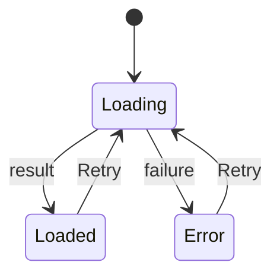
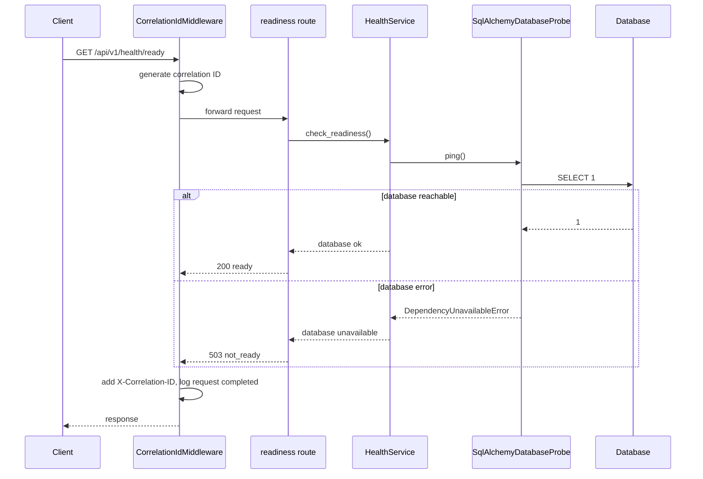
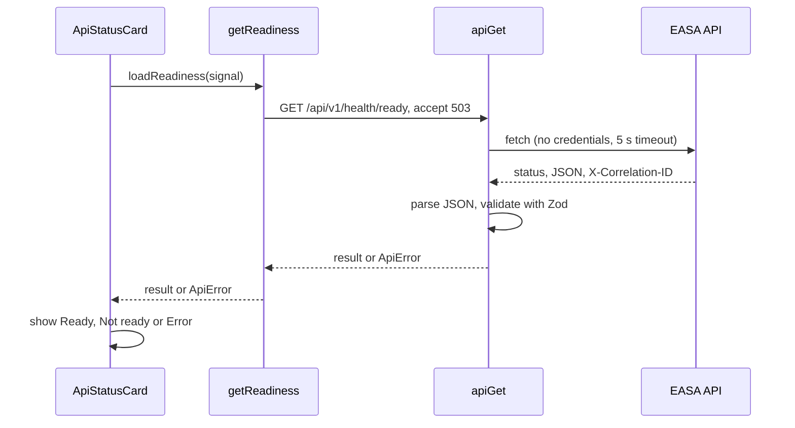

# EASA — Low-Level Design

> **Status:** describes the code as of M5 (commit `3371ec3` plus M5 changes), checked 2026-11-14. Planned work is labelled as such.

Related: [HLD](HLD.md) · [API specification](API_SPECIFICATION.md) · [Database design](DATABASE_DESIGN.md) · [Architecture decisions](ARCHITECTURE_DECISIONS.md)

## 1. Repository layout

```
easa/
  apps/api/                FastAPI backend (Python 3.14, uv)
    app/
      main.py              application factory: create_app()
      core/                config, correlation IDs, logging, errors, middleware, identity
      api/                 dependencies.py, v1/router.py, v1/routes/health.py, v1/routes/documents.py
      services/            health.py (HealthService, DatabaseProbe protocol),
                           uploads.py (upload validation), documents.py (DocumentService)
      schemas/             health.py, documents.py (response models)
      db/                  engine.py, session.py, base.py, models.py, probe.py,
                           types.py (UtcDateTime), documents.py (Document, DocumentChunk)
      repositories/        documents.py (tenant-scoped DocumentRepository)
      storage/             blob_store.py (BlobStore protocol, LocalBlobStore)
    migrations/            Alembic env.py, script template, versions/
    tests/                 unit/ and integration/
    alembic.ini, pyproject.toml, uv.lock, .env.example
  apps/web/                Next.js frontend
    src/app/               layout.tsx, page.tsx, globals.css
    src/components/        health/ApiStatusCard.tsx, layout/AppHeader.tsx, layout/SideNav.tsx
    src/lib/               config.ts, api/client.ts, api/schemas.ts, api/health.ts
    vitest.config.mts, vitest.setup.ts, next.config.ts, package.json, .env.example
  docs/                    this documentation set and PROGRESS.md
  scripts/                 check.ps1 (all checks), dev.ps1 (run both servers)
  .github/workflows/       ci.yml (GitHub Actions: API and web jobs)
```

## 2. Backend (`apps/api`)

### 2.1 Layers and dependency direction

```
routes (app/api)  ->  services (app/services)  ->  ports (Protocols in services)
                                                      ^
                          adapters (app/db/probe.py) -+
core (app/core) is used by every layer; it depends on no business code.
```

Routes stay thin: they resolve dependencies, call a service and map the result to a response schema. Services define the interfaces (ports) they need; adapters in `app/db` implement them. This is how `HealthService` depends on a `DatabaseProbe` protocol instead of SQLAlchemy ([ADR-008](ARCHITECTURE_DECISIONS.md#adr-008)).

### 2.2 Application factory — [app/main.py](../apps/api/app/main.py)

`create_app(settings: Settings | None = None) -> FastAPI`:

1. Loads `Settings` (or uses the ones passed in, which is how tests isolate configuration).
2. Calls `configure_logging(settings.log_level)`.
3. Creates the engine with `create_db_engine(...)`; a lifespan handler disposes it on shutdown.
4. Builds `FastAPI(title="EASA API", version="0.1.0")`. `/docs` and `/openapi.json` are `None` (disabled) when `environment == "production"`; ReDoc is always disabled.
5. Stores `settings`, `engine`, `session_factory` and `blob_store` (a `LocalBlobStore` rooted at `settings.storage_dir`) on `app.state`.
6. Registers exception handlers and includes the `/api/v1` router.
7. Adds middleware (see 2.4).

Run with `uv run uvicorn app.main:create_app --factory` so configuration is read at startup, not at import time.

### 2.3 Configuration — [app/core/config.py](../apps/api/app/core/config.py)

`Settings(BaseSettings)` with `env_prefix="EASA_"`, `env_file=".env"` (relative to the working directory), `extra="forbid"`, `frozen=True`, `hide_input_in_errors=True` ([ADR-005](ARCHITECTURE_DECISIONS.md#adr-005)).

| Field | Type | Default | Validation |
|---|---|---|---|
| `environment` | `"development" \| "test" \| "production"` | `development` | Literal |
| `log_level` | `DEBUG`…`CRITICAL` | `INFO` | Literal |
| `database_url` | `SecretStr` | `sqlite:///<apps/api>/var/easa.db` | Parsed with SQLAlchemy `make_url`; driver must be `sqlite`, `sqlite+pysqlite` or `postgresql+psycopg` |
| `cors_allowed_origins` | `list[str]` (JSON in env) | `["http://localhost:3000"]` | Each origin `http(s)://host[:port]`; no `*`, path, query or fragment; trailing `/` removed |

`is_production` is a convenience property. Validation errors never echo input values.

### 2.4 Middleware chain — [app/core/middleware.py](../apps/api/app/core/middleware.py)

Starlette runs the last-added middleware first. Effective order for a request, outermost first (FastAPI 0.162 also inserts `ExceptionTelemetryMiddleware` after #1 and `AsyncExitStackMiddleware` after #5; both are framework pass-through layers):

| # | Layer | Behaviour |
|---|---|---|
| 1 | Starlette `ServerErrorMiddleware` | Framework fallback (rarely reached; see #4) |
| 2 | `CorrelationIdMiddleware` | Generates `uuid4().hex` per HTTP request, stores it in a context variable, adds `X-Correlation-ID` to the response, logs `request completed` with `method`, `path`, `status_code`, `duration_ms` (query string deliberately omitted) |
| 3 | `CORSMiddleware` | Allowed origins from settings; `allow_methods=["GET"]`, `allow_headers=["Content-Type"]`, `allow_credentials=False`, exposes `X-Correlation-ID` |
| 4 | `UnhandledErrorMiddleware` | Catches any exception from the app, logs it with traceback, returns the standard 500 body. If the response had already started it re-raises |
| 4a | `BodySizeLimitMiddleware` | Rejects a declared `Content-Length` over `max_upload_bytes + 64 KiB` before reading; otherwise counts body bytes as they arrive and, if the limit is crossed, replaces the app's response with `413 request_too_large`. Malformed `Content-Length` → `400 invalid_content_length` |
| 5 | Starlette `ExceptionMiddleware` | Runs the registered exception handlers (2.5) |
| 6 | Router | `/api/v1/health`, `/api/v1/health/ready`; outside production also `/api/v1/documents` routes |

Because #4 sits inside #2 and #3, an unexpected error still returns a response carrying CORS headers and the correlation ID ([ADR-007](ARCHITECTURE_DECISIONS.md#adr-007)).

### 2.5 Errors — [app/core/errors.py](../apps/api/app/core/errors.py)

Response shape: `{"error": {"code", "message", "correlation_id", "details"?}}` (`details` omitted when empty).

| Exception | Status | `code` | `message` |
|---|---|---|---|
| `AppError(message, code=..., status_code=...)` | given | given | given (must be client-safe) |
| Starlette `HTTPException` (e.g. unknown route, wrong method) | its status | HTTP reason phrase in snake case (`not_found`, `method_not_allowed`) | `detail` if a string, else the reason phrase; exception headers (e.g. `Allow`) preserved |
| `RequestValidationError` | 422 | `validation_error` | `Request validation failed.`; `details` = `[{location, message, type}]`, never the submitted values |
| Any other exception | 500 | `internal_error` | `An unexpected error occurred.` |

### 2.6 Logging — [app/core/logging.py](../apps/api/app/core/logging.py)

`configure_logging(level)` installs one JSON handler on the root logger (stderr), removes Uvicorn's own handlers so `uvicorn` and `uvicorn.error` propagate to it, and raises `uvicorn.access` to `WARNING` (request logging is done by the middleware). `JsonFormatter` emits `timestamp` (UTC, milliseconds), `level`, `logger`, `message`, `correlation_id` (null outside a request), any `extra=` fields and `exception` when present. Uvicorn's ANSI `color_message` duplicate is dropped.

With `--reload`, the reloader supervisor process logs in plain text because it runs before the factory configures logging; the worker's logs are JSON.

### 2.6a Documents — routes, service, validation (P2-M2)

- [routes/documents.py](../apps/api/app/api/v1/routes/documents.py): `upload_document` (multipart field `file`; `201` new, `200` existing, `Location` header), `list_documents` (`limit` 1–200, `offset` ≥ 0), `get_document`. Handlers only resolve dependencies, call the service and map to `DocumentResponse`. Mounted in `create_app` only when not in production.
- [dependencies.py](../apps/api/app/api/dependencies.py): `get_identity` builds an `Identity` from `settings.dev_tenant_id` / `dev_user_id` ([ADR-014](ARCHITECTURE_DECISIONS.md#adr-014)); `get_document_service` wires the request session, `app.state.blob_store` and `max_upload_bytes`.
- [services/uploads.py](../apps/api/app/services/uploads.py): `sanitize_filename` and `validate_upload` → `ValidatedUpload(filename, media_type)` or `UploadRejectedError` (an `AppError` with a specific code and status). `DocxLimits` holds the zip-bomb limits.
- [services/documents.py](../apps/api/app/services/documents.py): `DocumentService.upload` validates, hashes, returns the existing document for known content, otherwise stores the blob **then** inserts the row and commits (an orphan blob is harmless; a row without a blob is not). A unique-constraint race with a concurrent identical upload is resolved by returning the winner. `get` raises `DocumentNotFoundError` (404) for missing and foreign documents alike.

### 2.7 Health — routes, service, probe

- [routes/health.py](../apps/api/app/api/v1/routes/health.py): `liveness()` takes no dependencies and returns `{"status": "ok"}`. `readiness()` gets a `HealthService` via `get_health_service`, sets status 503 when not ready and maps the report to `ReadinessResponse`.
- [services/health.py](../apps/api/app/services/health.py): `DatabaseProbe` protocol (`ping() -> None`, raises `DependencyUnavailableError`), immutable `ReadinessReport(database: "ok" | "unavailable")`, `HealthService.check_readiness()`.
- [db/probe.py](../apps/api/app/db/probe.py): `SqlAlchemyDatabaseProbe.ping()` runs `SELECT 1`. On `SQLAlchemyError` it logs `database ping failed` with only `error_type` (driver messages can contain connection details) and raises `DependencyUnavailableError("database")`.

### 2.8 Database access

See [DATABASE_DESIGN.md](DATABASE_DESIGN.md) for details. In short: `create_db_engine` (engine options and SQLite pragmas), `create_session_factory`, `session_scope` (commit or roll back) and `iter_session` / `get_db_session` (request-scoped, never commits implicitly). Document data goes through `DocumentRepository`, which requires a `tenant_id` on every call; file contents go through the `BlobStore` protocol ([ADR-015](ARCHITECTURE_DECISIONS.md#adr-015)).

## 3. Frontend (`apps/web`)

### 3.1 Structure and rules

- UI components never call `fetch`; they receive a loader function. The default loader calls the API client ([ADR-010](ARCHITECTURE_DECISIONS.md#adr-010)).
- Every API response is validated with a Zod schema before use.
- Only `NEXT_PUBLIC_*` values reach the browser, and none are secrets.

### 3.2 Configuration — [src/lib/config.ts](../apps/web/src/lib/config.ts)

`parsePublicConfig({ apiBaseUrl })` validates `NEXT_PUBLIC_API_BASE_URL` (default `http://localhost:8000`): an `http`/`https` URL with no path, query or fragment; trailing slashes are removed. Invalid values throw `Invalid NEXT_PUBLIC_API_BASE_URL: …`. `publicConfig` is evaluated at module load, so an invalid value makes `next build` fail while prerendering `/` (verified).

### 3.3 API client — [src/lib/api/client.ts](../apps/web/src/lib/api/client.ts)

`apiGet(baseUrl, path, { schema, acceptStatuses?, timeoutMs? = 5000, signal?, fetchImpl? })`:

1. Sends `GET {baseUrl}{path}` with `Accept: application/json`, `credentials: "omit"`, `cache: "no-store"` and an internal `AbortController`.
2. A timer aborts the request after `timeoutMs`; an external `signal` is forwarded.
3. Failure before a response: timeout → `ApiError("timeout")`; caller abort → the original abort error is re-thrown; anything else → `ApiError("network")`.
4. Reads the body as text and parses JSON; failure → `ApiError("invalid_response")`.
5. If the status is 2xx or listed in `acceptStatuses`, validates with `schema`; mismatch → `ApiError("invalid_response")`; success → `{ data, status, correlationId }`.
6. Otherwise parses the standard error envelope → `ApiError("http")` with the server's `code`, `message` and correlation ID (body value preferred over the header). A non-envelope error body gives a generic message: `The API request failed with status N.`

`getReadiness(baseUrl, options)` in [health.ts](../apps/web/src/lib/api/health.ts) calls `/api/v1/health/ready` with `acceptStatuses: [503]`, so `not_ready` is a valid result. Schemas are in [schemas.ts](../apps/web/src/lib/api/schemas.ts).

### 3.4 API status card — [ApiStatusCard.tsx](../apps/web/src/components/health/ApiStatusCard.tsx)

Client component with an injectable `loadReadiness(signal)` prop.



| State | Display |
|---|---|
| Loading | "Checking API readiness…"; Retry disabled |
| Loaded | "Ready" or "Not ready", and Database "OK" / "Unavailable" |
| Error | Friendly message per error kind (`network`, `timeout`, `invalid_response`; server message for `http`; a generic message for unexpected errors) and the correlation ID when known |

The status text is inside `role="status"` / `aria-live="polite"`. The effect aborts its request on unmount or retry and ignores late results.

### 3.5 Layout

[layout.tsx](../apps/web/src/app/layout.tsx) renders a skip link to `#main-content`, `AppHeader` ("Development build" badge), `SideNav` (labelled `Primary`; Dashboard link with `aria-current="page"`; Documents, Chat and Admin as `aria-disabled` text with their phase numbers) and the `main` landmark. Fonts are the system stack; no web fonts are downloaded.

## 4. Testing structure

| Suite | Location | Count | Notes |
|---|---|---|---|
| Backend unit | `apps/api/tests/unit/` | 86 | Config, health service (stub probe), JSON formatter, sessions and engine, blob store, UTC timestamp type, filename sanitizing and upload validation |
| Backend integration | `apps/api/tests/integration/` | 58 | Real app via `TestClient` with temporary SQLite files (health, errors, correlation IDs, CORS, logs, session dependency, document endpoints); body-size middleware on a minimal app; document repository against a temporary database; migration tests drive Alembic commands against temporary SQLite files |
| Frontend | `apps/web/src/**/*.test.ts(x)` | 27 | Config, API client with fake `fetch`, status card with fake loaders, navigation |

Test doubles are labelled in the code. `pytest` runs with warnings as errors and strict markers ([ADR-011](ARCHITECTURE_DECISIONS.md#adr-011)).

## 5. Sequence diagrams

### 5.1 Readiness request (backend)



### 5.2 Status card (frontend)



## 6. Extension points (planned)

| Need | Where it goes |
|---|---|
| New endpoint group | `app/api/v1/routes/<group>.py` + request/response models in `app/schemas/`, logic in `app/services/` |
| New table | Model in `app/db/` (imported by `app/db/models.py`) + reviewed Alembic migration |
| Data access | Repository classes using `Session` from `get_db_session`; services own commits |
| External systems (model, embeddings, vector store) | A Protocol in the service layer, an adapter outside it ([ADR-008](ARCHITECTURE_DECISIONS.md#adr-008) pattern) |
| New UI data | Zod schema + typed client function in `src/lib/api/`, component receives a loader |
