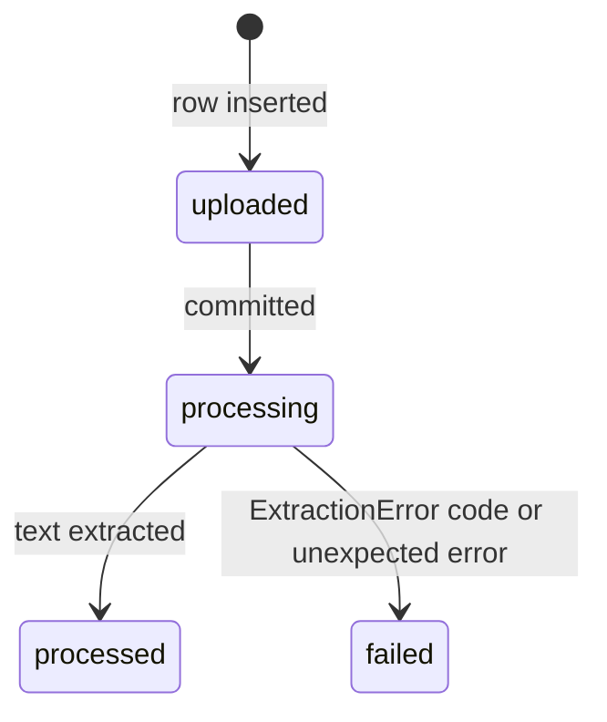
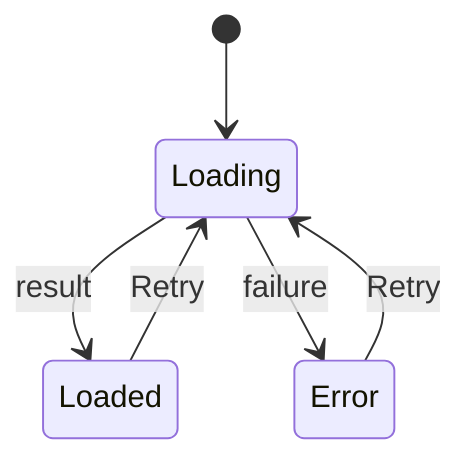
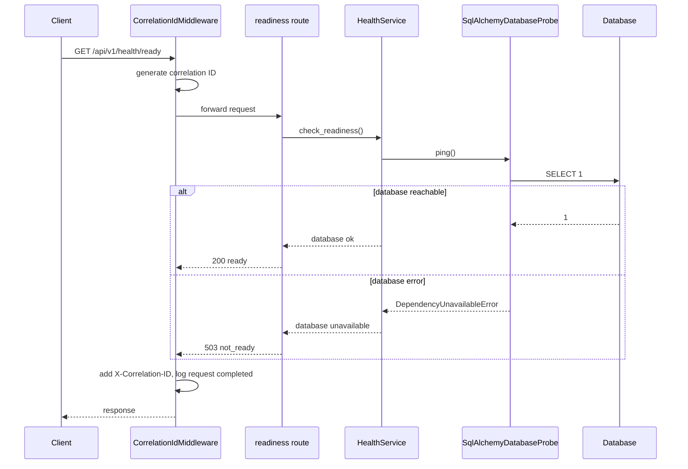
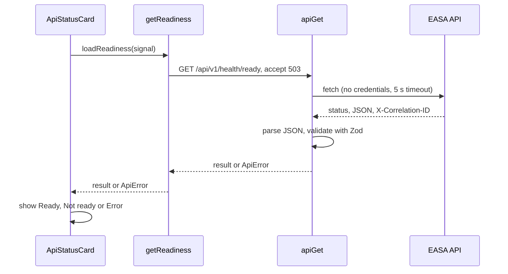

# EASA — Low-Level Design

> **Status:** describes the code as of M5 (commit `3371ec3` plus M5 changes), checked 2026-11-14. Planned work is labelled as such.

Related: [HLD](HLD.md) · [API specification](API_SPECIFICATION.md) · [Database design](DATABASE_DESIGN.md) · [Architecture decisions](ARCHITECTURE_DECISIONS.md)

## 1. Repository layout

```
easa/
  apps/api/                FastAPI backend (Python 3.14, uv)
    app/
      main.py              application factory: create_app()
      core/                config, correlation IDs, logging, errors, middleware, identity
      api/                 dependencies.py, v1/router.py, v1/routes/health.py, v1/routes/documents.py
      services/            health.py (HealthService, DatabaseProbe protocol),
                           uploads.py (upload validation), documents.py (DocumentService)
      schemas/             health.py, documents.py (response models)
      db/                  engine.py, session.py, base.py, models.py, probe.py,
                           types.py (UtcDateTime), documents.py (Document, DocumentChunk),
                           embeddings.py (ChunkEmbedding), fts.py (FTS5 keyword index DDL)
      repositories/        documents.py (tenant-scoped DocumentRepository), embeddings.py
      embeddings/          base.py (Embedder protocol), registry.py (pinned models), onnx.py,
                           hashing.py (test embedder), factory.py (provider + download)
      retrieval/           base.py (VectorIndex, KeywordIndex protocols), brute_force.py (exact search),
                           pgvector_index.py (PostgreSQL), keyword.py (FTS5 and PostgreSQL
                           full-text search), hybrid.py (reciprocal rank fusion), factory.py
      storage/             blob_store.py (BlobStore protocol, LocalBlobStore)
    migrations/            Alembic env.py, script template, versions/
    tests/                 unit/, integration/, model/ (real embedding model), postgres/
    alembic.ini, pyproject.toml, uv.lock, .env.example
  apps/web/                Next.js frontend
    src/app/               layout.tsx, page.tsx, globals.css
    src/components/        health/ApiStatusCard.tsx, layout/AppHeader.tsx, layout/SideNav.tsx
    src/lib/               config.ts, api/client.ts, api/schemas.ts, api/health.ts
    vitest.config.mts, vitest.setup.ts, next.config.ts, package.json, .env.example
  docs/                    this documentation set and PROGRESS.md
  compose.yaml             local PostgreSQL 18 + pgvector (optional; P3-M4)
  scripts/                 check.ps1 (all checks), dev.ps1 (run both servers)
  .github/workflows/       ci.yml (GitHub Actions: API and web jobs)
```

## 2. Backend (`apps/api`)

### 2.1 Layers and dependency direction

```
routes (app/api)  ->  services (app/services)  ->  ports (Protocols in services)
                                                      ^
                          adapters (app/db/probe.py) -+
core (app/core) is used by every layer; it depends on no business code.
```

Routes stay thin: they resolve dependencies, call a service and map the result to a response schema. Services define the interfaces (ports) they need; adapters in `app/db` implement them. This is how `HealthService` depends on a `DatabaseProbe` protocol instead of SQLAlchemy ([ADR-008](ARCHITECTURE_DECISIONS.md#adr-008)).

### 2.2 Application factory — [app/main.py](../apps/api/app/main.py)

`create_app(settings: Settings | None = None) -> FastAPI`:

1. Loads `Settings` (or uses the ones passed in, which is how tests isolate configuration).
2. Calls `configure_logging(settings.log_level)`.
3. Creates the engine with `create_db_engine(...)`; a lifespan handler disposes it on shutdown.
4. Builds `FastAPI(title="EASA API", version="0.1.0")`. `/docs` and `/openapi.json` are `None` (disabled) when `environment == "production"`; ReDoc is always disabled.
5. Stores `settings`, `engine`, `session_factory` and `blob_store` (a `LocalBlobStore` rooted at `settings.storage_dir`) on `app.state`.
6. Registers exception handlers and includes the `/api/v1` router.
7. Adds middleware (see 2.4).

Run with `uv run uvicorn app.main:create_app --factory` so configuration is read at startup, not at import time.

### 2.3 Configuration — [app/core/config.py](../apps/api/app/core/config.py)

`Settings(BaseSettings)` with `env_prefix="EASA_"`, `env_file=".env"` (relative to the working directory), `extra="forbid"`, `frozen=True`, `hide_input_in_errors=True` ([ADR-005](ARCHITECTURE_DECISIONS.md#adr-005)).

| Field | Type | Default | Validation |
|---|---|---|---|
| `environment` | `"development" \| "test" \| "production"` | `development` | Literal |
| `log_level` | `DEBUG`…`CRITICAL` | `INFO` | Literal |
| `database_url` | `SecretStr` | `sqlite:///<apps/api>/var/easa.db` | Parsed with SQLAlchemy `make_url`; driver must be `sqlite`, `sqlite+pysqlite` or `postgresql+psycopg` |
| `cors_allowed_origins` | `list[str]` (JSON in env) | `["http://localhost:3000"]` | Each origin `http(s)://host[:port]`; no `*`, path, query or fragment; trailing `/` removed |

`is_production` is a convenience property. Validation errors never echo input values.

### 2.4 Middleware chain — [app/core/middleware.py](../apps/api/app/core/middleware.py)

Starlette runs the last-added middleware first. Effective order for a request, outermost first (FastAPI 0.162 also inserts `ExceptionTelemetryMiddleware` after #1 and `AsyncExitStackMiddleware` after #5; both are framework pass-through layers):

| # | Layer | Behaviour |
|---|---|---|
| 1 | Starlette `ServerErrorMiddleware` | Framework fallback (rarely reached; see #4) |
| 2 | `CorrelationIdMiddleware` | Generates `uuid4().hex` per HTTP request, stores it in a context variable, adds `X-Correlation-ID` to the response, logs `request completed` with `method`, `path`, `status_code`, `duration_ms` (query string deliberately omitted) |
| 3 | `CORSMiddleware` | Allowed origins from settings; `allow_methods=["GET"]`, `allow_headers=["Content-Type"]`, `allow_credentials=False`, exposes `X-Correlation-ID` |
| 4 | `UnhandledErrorMiddleware` | Catches any exception from the app, logs it with traceback, returns the standard 500 body. If the response had already started it re-raises |
| 4a | `BodySizeLimitMiddleware` | Rejects a declared `Content-Length` over `max_upload_bytes + 64 KiB` before reading; otherwise counts body bytes as they arrive and, if the limit is crossed, replaces the app's response with `413 request_too_large`. Malformed `Content-Length` → `400 invalid_content_length` |
| 5 | Starlette `ExceptionMiddleware` | Runs the registered exception handlers (2.5) |
| 6 | Router | `/api/v1/health`, `/api/v1/health/ready`; outside production also `/api/v1/documents` routes |

Because #4 sits inside #2 and #3, an unexpected error still returns a response carrying CORS headers and the correlation ID ([ADR-007](ARCHITECTURE_DECISIONS.md#adr-007)).

### 2.5 Errors — [app/core/errors.py](../apps/api/app/core/errors.py)

Response shape: `{"error": {"code", "message", "correlation_id", "details"?}}` (`details` omitted when empty).

| Exception | Status | `code` | `message` |
|---|---|---|---|
| `AppError(message, code=..., status_code=...)` | given | given | given (must be client-safe) |
| Starlette `HTTPException` (e.g. unknown route, wrong method) | its status | HTTP reason phrase in snake case (`not_found`, `method_not_allowed`) | `detail` if a string, else the reason phrase; exception headers (e.g. `Allow`) preserved |
| `RequestValidationError` | 422 | `validation_error` | `Request validation failed.`; `details` = `[{location, message, type}]`, never the submitted values |
| Any other exception | 500 | `internal_error` | `An unexpected error occurred.` |

### 2.6 Logging — [app/core/logging.py](../apps/api/app/core/logging.py)

`configure_logging(level)` installs one JSON handler on the root logger (stderr), removes Uvicorn's own handlers so `uvicorn` and `uvicorn.error` propagate to it, and raises `uvicorn.access` to `WARNING` (request logging is done by the middleware). `JsonFormatter` emits `timestamp` (UTC, milliseconds), `level`, `logger`, `message`, `correlation_id` (null outside a request), any `extra=` fields and `exception` when present. Uvicorn's ANSI `color_message` duplicate is dropped.

With `--reload`, the reloader supervisor process logs in plain text because it runs before the factory configures logging; the worker's logs are JSON.

### 2.6a Documents — routes, service, validation (P2-M2)

- [routes/documents.py](../apps/api/app/api/v1/routes/documents.py): `upload_document` (multipart field `file`; `201` new, `200` existing, `Location` header), `list_documents` (`limit` 1–200, `offset` ≥ 0), `get_document`, `list_document_chunks` (`limit` 1–500, default 100). Handlers only resolve dependencies, call the service and map to `DocumentResponse`. Mounted in `create_app` only when not in production.
- [dependencies.py](../apps/api/app/api/dependencies.py): `get_identity` builds an `Identity` from `settings.dev_tenant_id` / `dev_user_id` ([ADR-014](ARCHITECTURE_DECISIONS.md#adr-014)); `get_document_service` wires the request session, `app.state.blob_store` and `max_upload_bytes`.
- [services/uploads.py](../apps/api/app/services/uploads.py): `sanitize_filename` and `validate_upload` → `ValidatedUpload(filename, media_type)` or `UploadRejectedError` (an `AppError` with a specific code and status). `DocxLimits` holds the zip-bomb limits.
- [services/documents.py](../apps/api/app/services/documents.py): `DocumentService.upload` validates, hashes, returns the existing document for known content, otherwise stores the blob **then** inserts the row and commits (an orphan blob is harmless; a row without a blob is not). A unique-constraint race with a concurrent identical upload is resolved by returning the winner. `get` raises `DocumentNotFoundError` (404) for missing and foreign documents alike.

### 2.6b Processing — extraction and normalization (P2-M3)

`DocumentService.upload` calls `_process` for every newly created document (identical re-uploads are not reprocessed):



- [services/extraction.py](../apps/api/app/services/extraction.py) `extract_document(media_type, data, max_pdf_pages)` returns an `ExtractionResult`: ordered `TextBlock`s (`text`, `kind`, `page_number`, `section`) plus `page_count`. `ExtractionResult.text` joins blocks with a blank line; this canonical text is what chunk offsets (P2-M4) refer to.
  - **PDF** (`pypdf`): rejects encrypted files and files over the page limit, then one `page` block per page that has text (1-based `page_number`; text-less pages are skipped but counted). `PdfReadError` → `corrupt_file`.
  - **DOCX** (`python-docx`): walks paragraphs and tables in document order. `Title`/`Heading*` paragraphs become `heading` blocks and set the current `section`; paragraphs and tables (cells joined with ` | `, rows with newlines) inherit it. Any exception from opening the package → `corrupt_file`.
  - **TXT**: UTF-8 (BOM removed), split into `paragraph` blocks at blank lines.
  - No blocks at all → `no_extractable_text`.
  - **Budgets (P2-M5)**, enforced while blocks are produced by a `_Budget`: 5,000,000 characters including separators (`text_too_large`) and 50,000 blocks (`document_too_complex`); DOCX table text is checked against the remaining budget cell by cell.
  - **PDF limits (P2-M5)**: parsing runs inside `pypdf.apply_configuration(...)` with stream output limits of 20 MB (instead of 75 MB), at most 50 MB decoded per document, and a 30-second budget checked between pages; `LimitReachedError` → `resource_limit_exceeded`, other `PyPdfError` → `corrupt_file`. `pypdf`'s logger is set to ERROR.
  - **DOCX details (P2-M5)**: style names are resolved once per document (`Paragraph.style` did an XPath search per paragraph); table cells are read once per physical `<w:tc>`, ignoring `gridSpan`.
- [services/normalization.py](../apps/api/app/services/normalization.py) `normalize_text`: NFC; `\r\n`/`\r` → `\n`; zero-width characters and BOM removed; all other whitespace except newlines → single spaces; control characters removed; lines trimmed; hyphenated line breaks between lowercase letters joined (`infor-\nmation` → `information`); three or more newlines → two. Deterministic and idempotent.
- [services/chunking.py](../apps/api/app/services/chunking.py) `chunk_document(result, ChunkingConfig)` (P2-M4) returns `Chunk`s whose text is always exactly `result.text[char_start:char_end]`, trimmed of surrounding whitespace, at most `max_chars` long:
  - `fixed`: windows of up to `max_chars` over the whole text. A cut is placed after the last newline, else the last space, within the final 20% of the window (else at the limit); the next window starts `overlap_chars` back, moved forward to a word boundary.
  - `structured` (default): whole blocks are merged until the next block would exceed `max_chars`. A heading always starts a new chunk; a change of page or section ends one; a single block longer than `max_chars` is split with the `fixed` windows.
  - Each chunk takes `page_number` and `section` from the block where it starts, found by binary search over block end offsets (`bisect`), so chunking is O(chunks · log blocks). More than 20,000 chunks → `document_too_complex`. `ChunkingConfig` validates `max_chars >= 100` and `0 <= overlap_chars < max_chars / 2` (mirrored in `Settings`).
- Outcome handling: chunks are written with `replace_chunks` in the same transaction as the final status. `ExtractionError` → `failed` with its code; any other exception (parsing or chunking) → rollback of partial chunks, logged with traceback, `failed` with `processing_error`; success → `processed`, `page_count` and `chunking_config`. One `document processed` log line per document with metadata only (block and chunk counts, never text).
- Unexpected failures are logged at ERROR with the exception type only; the traceback goes to DEBUG (it can quote file content).
- Interrupted documents: an identical re-upload of a document still `uploaded`/`processing` whose `updated_at` is older than `STALE_PROCESSING_AFTER` (10 minutes) runs `_process` again with the uploaded bytes.
- `DocumentService.list_chunks` first resolves the document for the tenant (404 otherwise), then returns a page of chunks and the total count.

### 2.6c Embeddings (P3-M1)

- [embeddings/base.py](../apps/api/app/embeddings/base.py): the `Embedder` protocol (`model_id`, `dimensions`, `is_available()`, `embed(texts)` returning an L2-normalized float32 array of shape `(n, dimensions)`) and `EmbeddingUnavailableError`.
- [embeddings/registry.py](../apps/api/app/embeddings/registry.py): `EmbeddingModelSpec` and the default model, `bge-small-en-v1.5`: repo `Qdrant/bge-small-en-v1.5-onnx-Q`, revision `aa8f8b06…`, 384 dimensions, MIT licence, an explicit file list. `model_id` = `name@revision[:12]`.
- [embeddings/onnx.py](../apps/api/app/embeddings/onnx.py) `OnnxEmbedder`: loads fastembed `TextEmbedding` lazily (thread-safe) from `<EASA_EMBEDDING_MODEL_DIR>/<name>/<revision>` with `specific_model_path` and `local_files_only=True`, so it never downloads at runtime. Missing files raise `EmbeddingUnavailableError`.
- [embeddings/hashing.py](../apps/api/app/embeddings/hashing.py) `HashingEmbedder` (`hashing-v1-384`): **not semantic**. A signed bag of hashed word tokens; deterministic and offline, for tests, CI and development without the model.
- [embeddings/factory.py](../apps/api/app/embeddings/factory.py): `build_embedder(settings)` (`EASA_EMBEDDING_PROVIDER` = `onnx` | `hashing`) and `download_model()` (`huggingface_hub.snapshot_download` at the pinned revision, allowed files only).
- [services/embedding_service.py](../apps/api/app/services/embedding_service.py) `EmbeddingService`: `embed_chunks` (batches of `EASA_EMBEDDING_BATCH_SIZE`; checks the result shape; stores and commits) and `embed_missing` (backfill across tenants, for the CLI only).
- [repositories/embeddings.py](../apps/api/app/repositories/embeddings.py): `add`, `chunks_without_embedding(model_id)` (chunks of processed documents only), `vectors_for_document(tenant_id, …)`; float32 encoding and decoding with a dimension check.
- Processing: after a document commits as `processed`, `DocumentService._embed` embeds its chunks as a separate unit of work. A failure is rolled back and logged as `document embedding skipped` (with the error type), and the document stays `processed`.
- `app.state.embedder` is built at startup (model loaded on first use) and is also the readiness probe (`checks.embeddings`).
- [cli.py](../apps/api/app/cli.py): `python -m app.cli download-embedding-model`, `python -m app.cli embed-missing [--limit N]` and `python -m app.cli rebuild-keyword-index` (section 2.6e).

### 2.6d Semantic search (P3-M2) and search modes (P3-M3)

- [retrieval/base.py](../apps/api/app/retrieval/base.py): the `VectorIndex` protocol, `search(tenant_id, model_id, query_vector, top_k) -> [ScoredChunk(chunk_id, score)]`. Implementations must filter by tenant, processed status and model **before** scoring.
- [retrieval/brute_force.py](../apps/api/app/retrieval/brute_force.py) `BruteForceVectorIndex`: one SQL query joins `chunk_embeddings` → `document_chunks` → `documents`, filtered by `model_id`, `tenant_id` (on both the vector and the document) and `status = processed`. Rows are streamed in batches of 5,000 (`yield_per`), so memory is bounded by the batch size, and each batch is scored with one matrix-vector product. A running top-k is kept; ties are broken by chunk ID so results are deterministic and independent of batch size. Works on any SQL backend; exact.
- [services/search.py](../apps/api/app/services/search.py) `SearchService(session, embedder, index, keyword_index).search(identity, query, *, top_k, mode=semantic)`: normalizes the query like chunk text; rejects empty (`empty_query`) or out-of-range input; returns `503 embeddings_unavailable` when the model is missing (not in `keyword` mode, which needs no embedder). Per mode:
  - `semantic`: embeds the query with `Embedder.embed_query` (fastembed's query handling for the ONNX model) and asks the `VectorIndex`.
  - `keyword`: asks the `KeywordIndex` protocol (`search(tenant_id, query, top_k)`); `model_id` in the result is `None`.
  - `hybrid`: takes `max(4 × top_k, 20)` candidates (`MIN_HYBRID_CANDIDATES`) from both rankings and fuses them with reciprocal rank fusion.

  It then loads chunk and document details in one tenant-scoped query (`DocumentRepository.chunks_with_documents`), skipping chunks deleted in between. It logs mode, model ID, `top_k`, result count and duration, never the query.
- [routes/search.py](../apps/api/app/api/v1/routes/search.py): `POST /api/v1/search` (`SearchRequest` forbids unknown fields; `mode` is a `SearchMode` enum) → `SearchResponse` (`mode`, nullable `model_id`) with a `Citation` per hit. Mounted only outside production, next to the document routes. `get_search_service` gets the indexes for the request session from `build_indexes` (section 2.6f).

### 2.6e Keyword and hybrid retrieval (P3-M3)

- [db/fts.py](../apps/api/app/db/fts.py): `KEYWORD_INDEX_DDL` (the external-content FTS5 table `chunk_fts` plus insert, delete and update triggers on `document_chunks`), `create_keyword_index`, `rebuild_keyword_index` and `is_keyword_index_object` (used by the Alembic `include_name` filter). The migration `6d544dac46b3` contains the same statements; a test compares the two. See [DATABASE_DESIGN.md section 8.1](DATABASE_DESIGN.md#81-keyword-index-phase-3-implemented-in-p3-m3).
- [retrieval/keyword.py](../apps/api/app/retrieval/keyword.py):
  - `build_match_query(query)`: lower-cases, extracts `\w+` tokens, removes duplicates, keeps at most `MAX_QUERY_TERMS` (32), quotes each token and joins them with `OR`. Returns `None` when there are no tokens. User text never reaches FTS5 query syntax directly.
  - `SqliteKeywordIndex.search(tenant_id, query, top_k)`: one SQL query joins `chunk_fts` → `document_chunks` (by `rowid`) → `documents`, filtered by tenant (on both the chunk and the document) and `status = processed`, ordered by `bm25()` then chunk ID. The score is `-bm25` (higher is better). On a database other than SQLite it raises `503 keyword_search_unavailable`.
- [retrieval/hybrid.py](../apps/api/app/retrieval/hybrid.py) `reciprocal_rank_fusion(rankings, *, top_k, k=60)`: each chunk scores `Σ 1 / (k + rank)` over the rankings it appears in (rank starts at 1). Only positions matter, so BM25 and cosine scores never need to be put on one scale. Ties are broken by chunk ID.

### 2.6f PostgreSQL retrieval (P3-M4)

- [db/types.py](../apps/api/app/db/types.py) `EmbeddingVector`: a `TypeDecorator` whose Python value is always float32 little-endian `bytes`. `load_dialect_impl` returns `LargeBinary` on SQLite and pgvector's `VECTOR()` (no dimension) on PostgreSQL; bind and result processing convert bytes to and from NumPy arrays on PostgreSQL only. Repositories and `BruteForceVectorIndex` work unchanged on both backends. Alembic renders the type as `sa.LargeBinary()`; the PostgreSQL migration converts the column.
- [retrieval/pgvector_index.py](../apps/api/app/retrieval/pgvector_index.py) `PgvectorIndex.search(tenant_id, model_id, query, top_k)`: one SQLAlchemy query selecting `chunk_id` and `vector <=> CAST(:query_vector AS VECTOR)`, joined to chunks and documents, filtered by model, tenant (vector and document), processed status and `dimensions = len(query)`, ordered by distance then chunk ID, limited to `top_k`. Score = `1 - distance`. No ANN index, so results are exact.
- [retrieval/keyword.py](../apps/api/app/retrieval/keyword.py): `query_terms` (shared token extraction); `build_tsquery` quotes each token and joins with ` | `. `PostgresKeywordIndex` runs `POSTGRES_KEYWORD_SQL`: `to_tsquery('english', :match)` cross-joined once, `to_tsvector('english', dc.text) @@ query` (the GIN index expression), tenant and status filters, `ORDER BY ts_rank_cd(...) DESC, dc.id`. Each implementation raises `503 keyword_search_unavailable` on the other backend.
- [retrieval/factory.py](../apps/api/app/retrieval/factory.py) `build_indexes(session)`: `(PgvectorIndex, PostgresKeywordIndex)` on PostgreSQL, `(BruteForceVectorIndex, SqliteKeywordIndex)` otherwise.

### 2.7 Health — routes, service, probe

- [routes/health.py](../apps/api/app/api/v1/routes/health.py): `liveness()` takes no dependencies and returns `{"status": "ok"}`. `readiness()` gets a `HealthService` via `get_health_service`, sets status 503 when not ready and maps the report to `ReadinessResponse`.
- [services/health.py](../apps/api/app/services/health.py): `DatabaseProbe` protocol (`ping() -> None`, raises `DependencyUnavailableError`), immutable `ReadinessReport(database: "ok" | "unavailable")`, `HealthService.check_readiness()`.
- [db/probe.py](../apps/api/app/db/probe.py): `SqlAlchemyDatabaseProbe.ping()` runs `SELECT 1`. On `SQLAlchemyError` it logs `database ping failed` with only `error_type` (driver messages can contain connection details) and raises `DependencyUnavailableError("database")`.

### 2.8 Database access

See [DATABASE_DESIGN.md](DATABASE_DESIGN.md) for details. In short: `create_db_engine` (engine options and SQLite pragmas), `create_session_factory`, `session_scope` (commit or roll back) and `iter_session` / `get_db_session` (request-scoped, never commits implicitly). Document data goes through `DocumentRepository`, which requires a `tenant_id` on every call; file contents go through the `BlobStore` protocol ([ADR-015](ARCHITECTURE_DECISIONS.md#adr-015)).

## 3. Frontend (`apps/web`)

### 3.1 Structure and rules

- UI components never call `fetch`; they receive a loader function. The default loader calls the API client ([ADR-010](ARCHITECTURE_DECISIONS.md#adr-010)).
- Every API response is validated with a Zod schema before use.
- Only `NEXT_PUBLIC_*` values reach the browser, and none are secrets.

### 3.2 Configuration — [src/lib/config.ts](../apps/web/src/lib/config.ts)

`parsePublicConfig({ apiBaseUrl })` validates `NEXT_PUBLIC_API_BASE_URL` (default `http://localhost:8000`): an `http`/`https` URL with no path, query or fragment; trailing slashes are removed. Invalid values throw `Invalid NEXT_PUBLIC_API_BASE_URL: …`. `publicConfig` is evaluated at module load, so an invalid value makes `next build` fail while prerendering `/` (verified).

### 3.3 API client — [src/lib/api/client.ts](../apps/web/src/lib/api/client.ts)

`apiGet(baseUrl, path, { schema, acceptStatuses?, timeoutMs? = 5000, signal?, fetchImpl? })`:

1. Sends `GET {baseUrl}{path}` with `Accept: application/json`, `credentials: "omit"`, `cache: "no-store"` and an internal `AbortController`.
2. A timer aborts the request after `timeoutMs`; an external `signal` is forwarded.
3. Failure before a response: timeout → `ApiError("timeout")`; caller abort → the original abort error is re-thrown; anything else → `ApiError("network")`.
4. Reads the body as text and parses JSON; failure → `ApiError("invalid_response")`.
5. If the status is 2xx or listed in `acceptStatuses`, validates with `schema`; mismatch → `ApiError("invalid_response")`; success → `{ data, status, correlationId }`.
6. Otherwise parses the standard error envelope → `ApiError("http")` with the server's `code`, `message` and correlation ID (body value preferred over the header). A non-envelope error body gives a generic message: `The API request failed with status N.`

`getReadiness(baseUrl, options)` in [health.ts](../apps/web/src/lib/api/health.ts) calls `/api/v1/health/ready` with `acceptStatuses: [503]`, so `not_ready` is a valid result. Schemas are in [schemas.ts](../apps/web/src/lib/api/schemas.ts).

### 3.4 API status card — [ApiStatusCard.tsx](../apps/web/src/components/health/ApiStatusCard.tsx)

Client component with an injectable `loadReadiness(signal)` prop.



| State | Display |
|---|---|
| Loading | "Checking API readiness…"; Retry disabled |
| Loaded | "Ready" or "Not ready", and Database "OK" / "Unavailable" |
| Error | Friendly message per error kind (`network`, `timeout`, `invalid_response`; server message for `http`; a generic message for unexpected errors) and the correlation ID when known |

The status text is inside `role="status"` / `aria-live="polite"`. The effect aborts its request on unmount or retry and ignores late results.

### 3.5 Layout

[layout.tsx](../apps/web/src/app/layout.tsx) renders a skip link to `#main-content`, `AppHeader` ("Development build" badge), `SideNav` (labelled `Primary`; Dashboard link with `aria-current="page"`; Documents, Chat and Admin as `aria-disabled` text with their phase numbers) and the `main` landmark. Fonts are the system stack; no web fonts are downloaded.

## 4. Testing structure

| Suite | Location | Count | Notes |
|---|---|---|---|
| Backend unit | `apps/api/tests/unit/` | 195 | Config, health service (stub probe), JSON formatter, sessions and engine, blob store, UTC timestamp type, filename sanitizing and upload validation, text normalization, PDF/DOCX/TXT extraction, chunking strategies, embeddings (hashing embedder, vector encoding), reciprocal rank fusion, FTS5 and tsquery building |
| Backend integration | `apps/api/tests/integration/` | 131 | Real app via `TestClient` with temporary SQLite files (health, errors, correlation IDs, CORS, logs, session dependency, document and search endpoints in all three modes); body-size middleware on a minimal app; document repository, embedding pipeline, vector index and keyword index against temporary databases (tenant and status isolation, FTS syntax injection, trigger synchronization, rebuild command); migration tests drive Alembic commands against temporary SQLite files |
| PostgreSQL | `apps/api/tests/postgres/` | 44 | Run only with `EASA_TEST_POSTGRES_URL`; throwaway databases migrated by Alembic. Migrations (upgrade, downgrade, `alembic check`), vector storage round trip, pgvector vs brute-force parity, tenant/status/model/dimension filters, keyword search (stemming, codes, hostile tsquery input, stop words, isolation, GIN index used per `EXPLAIN`), and the full app (upload, embeddings, readiness, all search modes). Always run in CI |
| Real embedding model | `apps/api/tests/model/` | 3 | Vector sanity checks and a semantic search through the API; skipped unless the pinned model is downloaded (always skipped in CI) |
| Frontend | `apps/web/src/**/*.test.ts(x)` | 27 | Config, API client with fake `fetch`, status card with fake loaders, navigation |

Test doubles are labelled in the code. `pytest` runs with warnings as errors and strict markers ([ADR-011](ARCHITECTURE_DECISIONS.md#adr-011)).

## 5. Sequence diagrams

### 5.1 Readiness request (backend)



### 5.2 Status card (frontend)



## 6. Extension points (planned)

| Need | Where it goes |
|---|---|
| New endpoint group | `app/api/v1/routes/<group>.py` + request/response models in `app/schemas/`, logic in `app/services/` |
| New table | Model in `app/db/` (imported by `app/db/models.py`) + reviewed Alembic migration |
| Data access | Repository classes using `Session` from `get_db_session`; services own commits |
| External systems (model, embeddings, vector store) | A Protocol in the service layer, an adapter outside it ([ADR-008](ARCHITECTURE_DECISIONS.md#adr-008) pattern) |
| New UI data | Zod schema + typed client function in `src/lib/api/`, component receives a loader |
